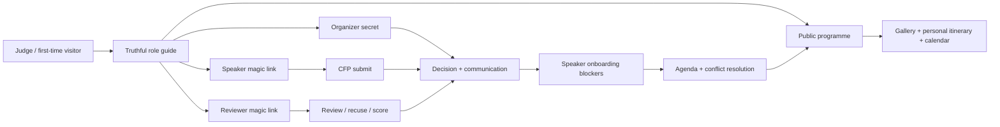
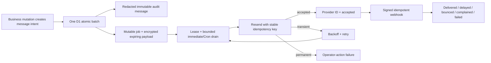

# Open Events Submission Readiness - Plan

## Goal Capsule

Finish Open Events as a submission-ready, judge-operable product whose complete
programme lifecycle can be demonstrated on Cloudflare without private database
inspection, unsafe production mutation, misleading copy, or Moiz standing next
to the evaluator.

The product is not starting from zero. Canonical `main` at
`bf9d14b55ace66cf741c312dd6049d52e0187acd` is deployed and already passes the
current release suite. It implements the CFP, review, decision, onboarding,
agenda, public programme, itinerary, gallery, iCal, and embed surfaces. The
remaining work is to close the reliability and presentation gap between
“feature exists” and “an independent judge can prove it end to end.”

The finishing outcome is:

1. A judge can understand the product and enter every role through truthful,
   secure instructions.
2. Speaker and reviewer magic links, submission confirmations, decisions,
   reminders, and calendar messages are durably queued and actually delivered.
3. A disposable Cloudflare acceptance environment can run the destructive
   golden lifecycle without changing the public showcase event.
4. The public event is richly populated enough to prove the active speaker
   gallery and mobile itinerary requirements, while every shipped image obeys
   the rule that it contains no women.
5. The operational desks answer “what needs attention now?” through filters,
   blockers, and direct actions.
6. The exact revision, database state, email outcome, domains, rendered UI, and
   submission package each have separate evidence.

Success is not “more features.” Success is a coherent five-minute proof of the
source-defined lifecycle, backed by production-grade access and delivery.

---

## Product Contract

### Source interpretation

The authoritative brief was reread in its rendered form, including all 37
pages, screenshots, red annotations, and strike-through formatting. The key
scope correction is that the “embeddable, mobile-friendly speaker gallery and
schedule itinerary” requirement is active. Only the preceding portal
resource/wiki and HTML-embed item is struck out. AI-assisted review,
Accelevents, and the resource/wiki requirement remain out of scope. Payments
are explicitly marked not needed. The form close date, submission confirmation,
and post-submit portal handoff are emphasized in the source and therefore stay
release-critical.

The intended product is an event-programme operating system, not a broad event
management suite and not a visual clone of Sessionboard. Its central value is
removing organizer follow-up work while making the next operational action
obvious.

### Actors

- A1 — Organizer: configures the event and CFP, manages proposals and reviews,
  communicates with speakers, tracks readiness, builds the agenda, and
  publishes the programme.
- A2 — Speaker/submitter: requests a magic link, submits or revises a proposal,
  receives confirmation and decisions, maintains a profile, uploads files, and
  completes onboarding tasks.
- A3 — Reviewer: receives a role-scoped link, works an assigned queue, scores,
  comments, recuses when conflicted, and submits the evaluation.
- A4 — Attendee: browses sessions and speakers, builds a device-local itinerary,
  and exports the programme to a calendar.
- A5 — Judge: evaluates the product as a first-time visitor and must be able to
  traverse A1–A4 without undocumented intervention.
- A6 — Release operator: prepares isolated data, provisions bindings and
  secrets, runs gates, deploys an exact revision, verifies rollback readiness,
  and assembles submission evidence.
- A7 — External delivery/runtime systems: Cloudflare Workers, D1, R2, DNS/TLS,
  Workers Logs, Cron Triggers, Resend, and the judge's actual inbox.

### Requirements

#### Submission viability and truth

- R1 — Treat the 37-page rendered brief and `finishing-openevents.md` as the
  scope baseline, with the gallery/itinerary correction carried into tests,
  demo data, copy, and the submission narrative.
- R2 — Verify the actual submission channel, current deadline or extension,
  judging rubric, required fields, repository rules, video limits,
  reimbursement evidence, and a private credential handoff before final release
  work is called submission-ready.
- R3 — Keep the live URL, public repository, Apache-2.0 license, architecture
  description, limitations, and judge instructions mutually consistent.
- R4 — Describe captured intent, provider acceptance, webhook delivery, and
  inbox receipt as different proof states; never label a captured row “sent.”

#### Secure judge access

- R5 — Give A5 exact entry instructions for organizer, speaker, reviewer, and
  public attendee roles without adding a public role switch or authorization
  bypass.
- R6 — Keep the private organizer secret as the competition access path unless
  Clerk gains an explicit organizer allowlist or organization-role policy.
  Time-box its judge distribution and rotate it after the evaluation window.
- R7 — Protect organizer login, magic-link requests, and token redemption with
  cheap burst limits plus transactional per-recipient and environment-wide mail
  budgets, and require a server-validated human challenge for anonymous
  production start requests. Preserve the generic public-start response that
  prevents account enumeration.
- R8 — Keep session cookies HttpOnly, SameSite, Secure on HTTPS, bounded by the
  existing TTL policy, and protected by the existing CSRF origin allowlist.
  Carry a token's role capability into the redeemed session and enforce that
  capability on every protected route and service.
- R9 — Generate externally usable absolute links from a validated canonical
  public origin, never from an untrusted request `Host` header.
- R10 — Make expired, invalid, wrong-role, and permission-denied states explain
  the correct recovery action without leaking account or token information.

#### Durable communications

- R11 — Atomically create a durable delivery job whenever any application path
  creates a captured message: speaker/reviewer start links, submission
  confirmations, acceptances, reminders, calendar invitations, and applicable
  support notifications.
- R12 — Preserve the business mutation if provider delivery fails; the durable
  job must retry without duplicating a submission, session token, confirmation,
  or provider message.
- R13 — Persist provider acceptance, provider ID, attempt count, retry time,
  lease, redacted failure class, and terminal delivery state separately from a
  redacted immutable audit message. Keep any sendable bearer-token payload
  encrypted, access-controlled, expiring, and clearable after provider
  acceptance or token expiry.
- R14 — Verify signed Resend webhooks idempotently and project out-of-order
  events through an explicit transition lattice for sent, delivered, delayed,
  bounced, complained, and failed outcomes; a complaint may follow delivery.
- R15 — Keep local development and ordinary tests capture-only; use a restricted
  provider-test mode in acceptance and an explicit live mode in production.
- R16 — Surface delivery state and safe retry/recovery information to A1 without
  exposing magic tokens, bodies, recipient addresses in logs, or provider
  secrets.

#### Source-defined lifecycle

- R17 — Preserve the existing versioned, conditional CFP and its event-owned
  taxonomy/routing behavior rather than replacing the builder.
- R18 — Store the organizer's success content with the published form version.
  After a successful submission, announce that confirmation accessibly, send
  the confirmation message, and complete the source-emphasized portal handoff
  with an immediate link plus a cancellable delayed redirect.
- R19 — Preserve reviewer assignment, blind-review behavior, scoring, comments,
  recusal, weighted results, and organizer decisions as one coherent state
  machine.
- R20 — Preserve the accepted-speaker portal for every contributor, with
  purpose-bound access to profile, headshot, reviewed PDF/PPTX materials,
  travel/confirmation, tasks, and self-service updates. Treat every upload as
  untrusted private content and never serve documents inline.
- R21 — Preserve agenda placement, conflict detection and resolution, publish/
  unpublish behavior, and list/day/week/track/room programme views.
- R22 — Treat the embeddable public speaker gallery and mobile day itinerary as
  active core requirements. “Itinerary” is the useful day-based programme view;
  “My schedule” is the device-local starred collection. Demonstrate gallery and
  itinerary as responsive HTML embeds with coherent, populated production data.
- R23 — Make calendar semantics truthful: “My schedule” exports only the
  selected published sessions, while accepted contributors receive an
  invitation derived from the canonical published session slot and room, not
  the event-wide date range.

#### Operational depth and presentation

- R24 — Extend the submissions desk with decision/routing/form filters, useful
  sorting, column control, filtered totals/reset, and CSV export; do not add
  unsupported bulk decisions or premature server pagination.
- R25 — Turn readiness into an actionable “today” surface with blocker-first
  ordering, outstanding task kinds, review/schedule warnings, and direct paths
  to the affected record or reminder action.
- R26 — Preserve the established component system and visual grammar while
  tightening hierarchy, rhythm, labels, status semantics, and action priority.
- R27 — Give public session, speaker, detail, and schedule surfaces distinct
  loading, retryable error, true empty, no-filter-match, and not-found states.
- R28 — Make homepage, tour, role gates, emails, success states, and README copy
  accurate about access, delivery, itinerary scope, and known limitations.
- R29 — Maintain keyboard access, visible focus, live-region discipline,
  reduced-motion behavior, semantic headings/tables, contrast, and a minimum
  24-by-24 CSS-pixel rendered target for actions across the full populated
  lifecycle, with any target-size exception documented and reviewed.
- R30 — No shipped or submission-package image may contain a woman. Prefer
  abstract visuals or explicitly reviewed male-only imagery; maintain a manual
  asset inventory and visual sign-off because filename/static checks cannot
  prove image content.

#### Cloudflare, proof, and maintainability

- R31 — Add a distinct acceptance Worker environment with its own D1, R2,
  variables, secrets, Cron bindings, and resettable data; it must not use the
  production custom domain or production resources. Any reset mechanism uses a
  separate release-operator credential and fails closed outside acceptance.
- R32 — Keep the public showcase dataset stable. Never run a destructive reset
  or the mutating golden lifecycle against its D1/R2 resources.
- R33 — Expose non-secret build/revision identity through health and structured
  logs so a deployed version can be tied to source without relying on prose.
- R34 — Parameterize live browser targets and keep Worker-version, database,
  DNS/TLS, email, and rendered-browser receipts separate.
- R35 — Add clean-checkout CI using the repository's existing gates and locked
  toolchain; do not invent a parallel build/test stack.
- R36 — Keep D1 migrations additive and use a two-release expansion protocol:
  first deploy a capture-only compatibility writer that understands old and new
  rows and becomes the rollback target, then activate live draining only after
  no legacy writer can receive traffic. Back up and verify D1 independently
  because Worker rollback does not roll back data.
- R37 — Keep API/OpenAPI work outside the submission-critical path. If time
  remains, document only existing public read endpoints without route-framework
  migration or invented capabilities.
- R38 — Keep the optional feed matrix bounded to sessions JSON, speakers JSON,
  agenda HTML, and full-schedule iCalendar. Support track filtering only for
  sessions/agenda, and remove XML plus every other kind/format/filter
  combination from controls and documentation.

### Key flows

- F1 — First-time judge orientation: A5 lands on the public event, understands
  the lifecycle, sees truthful role gates, reads the short judge guide, and can
  reach the public programme immediately.
- F2 — Speaker submission: A2 requests a link, receives and redeems an absolute
  URL, completes a conditional CFP, saves a draft, submits once, hears/sees the
  confirmation, receives confirmation mail, and arrives in the portal.
- F3 — Review: A1 opens a round and assigns A3; A3 receives a link, signs in,
  scores or recuses, submits, and advances through the queue; A1 sees the
  resulting progress and weighted outcome.
- F4 — Decision and communication: A1 accepts/rejects a proposal, previews and
  sends the correct template, and sees delivery move from queued to provider
  accepted to delivered or an actionable failure.
- F5 — Accepted-speaker onboarding: A2 edits profile data, supplies a compliant
  headshot/file, confirms required items, and sees one clear next task; A1 sees
  the corresponding blockers disappear.
- F6 — Programme publication: A1 places accepted sessions, encounters and
  resolves a deterministic conflict, publishes, and sees only valid accepted
  sessions on public views.
- F7 — Public programme: A4 filters sessions/speakers, opens speaker detail,
  stars sessions, sees a useful default itinerary on phone, and downloads the
  correctly labeled calendar feed.
- F8 — Delivery recovery: a transient provider failure leaves business data
  committed, retries once eligible, cannot double-send after acceptance, and
  reconciles signed webhook outcomes.
- F9 — Repeatable acceptance: A6 resets only the isolated acceptance resources,
  applies the showcase fixture, executes F2–F7 through real UI and real test
  mail, then proves final D1/R2 state.
- F10 — Release and submission: A6 ties a clean source revision to CI, migration,
  Worker version, domain, inbox, visual, and submission-package evidence, with a
  rehearsed rollback boundary.

### Acceptance examples

- AE1 — Given an unknown email, when `/api/public/start` is requested, the UI
  and API reveal no account existence while server human verification, burst
  limits, recipient cooldown/daily budget, and environment budget prevent
  repeated provider-eligible delivery intent.
- AE2 — Given a production start request, the received email contains an HTTPS
  absolute URL on the canonical domain; redeeming it once succeeds and a second
  redemption fails safely.
- AE3 — Given Resend is configured, a speaker magic link and a submission
  confirmation both create delivery jobs and reach an authorized real inbox;
  neither is proven by reading D1 directly.
- AE4 — Given Resend returns a transient failure, the submission remains valid,
  the job becomes retryable, and only one provider message is ultimately
  accepted.
- AE5 — Given a duplicate or out-of-order webhook, only one webhook event is
  recorded and the explicit transition lattice preserves complaint after
  delivery without regressing terminal bounce/failure/complaint states.
- AE6 — Given a valid Clerk user who is not an authorized organizer, the user
  cannot create an organizer session. If no authorization policy is configured,
  the production Clerk entry is disabled. A redeemed evaluation capability also
  cannot call CFP or portal operations.
- AE7 — Given a completed CFP submission, screen-reader focus reaches the
  confirmation before any delayed portal navigation, and the user can enter or
  cancel the redirect immediately.
- AE8 — Given a populated submissions list, A1 can combine decision and routing
  filters, sort, hide/show useful columns, reset the view, and export exactly
  the filtered rows with stable headings.
- AE9 — Given mixed onboarding state, the readiness surface ranks incomplete
  work first, names the missing task kinds, links to the exact record, and does
  not expose speaker identity beyond the accepted privacy boundary.
- AE10 — Given public APIs are loading or fail, the UI does not claim there are
  zero sessions/speakers or that a speaker does not exist; it shows a focused,
  retryable state.
- AE11 — Given the showcase event on a 390-pixel-wide viewport, the speaker
  gallery has multiple coherent profiles, Itinerary opens on the first
  published day, My schedule contains only starred sessions, all views fit
  without overflow, and its iCalendar file matches those selections.
- AE12 — Given an advertised embed kind/format/filter combination, its payload
  and preview obey the explicit core/P1 matrix; XML and unsupported combinations
  do not appear.
- AE13 — Given the repository and submission package, an asset inventory plus
  human visual review confirms that no image contains a woman.
- AE14 — Given the acceptance target, the full golden lifecycle may be reset and
  rerun against the judge sandbox without changing curated production rows or R2
  objects, and production exposes no working reset route.
- AE15 — Given a release candidate, health reports its exact build identity;
  clean CI, D1 migration, Worker version, DNS/TLS, inbox delivery, desktop/phone
  rendering, and submission receipt are evidenced independently.

### Scope

#### P0 — submission blockers

- R1–R13, R15, R17–R23, and R27–R36. For R29, the P0 matrix is the
  judge-critical path at 390 and 1440 pixels with keyboard, axe, contrast,
  touch-target, and no-overflow checks.
- External confirmation of the submission channel and deadline.
- Secure role access, canonical absolute links, rate limiting, Clerk lockdown,
  durable provider-accepted delivery plus owned-inbox proof, isolated acceptance
  data, coherent showcase data, exact build identity, and repeatable end-to-end
  proof.

#### P1 — judged product depth

- R14, R16, R24–R26, R38, and the extended R27–R29 state/viewport/theme matrix.
- Submission operations, actionable readiness, truthful public states, role-
  aware tour/copy, gallery/itinerary population, embed truth, visual cohesion,
  accessibility, and responsive proof.

#### P2 — only after the judged lifecycle is green

- R37 and optional enhancements to submission media or analytics that do not
  displace P0/P1.
- A bounded public API reference for existing read endpoints.

#### Explicit non-goals

- AI-assisted proposal scoring or expanded Orby scope.
- Accelevents, Airtable migration, payments, ticketing, broad CRM/CMS, or a
  resource/wiki builder.
- A public demo-role bypass, shared speaker account, or committed credentials.
- Better Auth migration, a new backend service, Queue/Durable Object adoption,
  or a distributed architecture.
- Full Sessionboard visual imitation.
- Server-side pagination or bulk-decision workflows without measured need.
- OpenAPI-driven refactoring of the existing Hono route surface.

---

## Planning Contract

### Current baseline and evidence boundary

- Plan and implement from a clean worktree at canonical `main` or newer. The
  root checkout is stale and dirty; it is not an implementation base.
- The `.worktrees/integration-audit` tree is content-identical to deployed
  canonical `main` and is the source used for this plan's file mapping.
- The current production Worker, D1 migrations, DNS/TLS, and read-only rendered
  schedule have prior independent receipts. The mutating production lifecycle
  and real inbox delivery do not.
- The historical `session-board` VM is no longer present in the live exe.dev
  inventory. This plan does not depend on that remote fleet; any new remote
  execution requires fresh authorization and inventory.

### Repository and external findings that change the plan

| Finding                                                   | Evidence                                                                                                        | Planning consequence                                                                                    |
| --------------------------------------------------------- | --------------------------------------------------------------------------------------------------------------- | ------------------------------------------------------------------------------------------------------- |
| Critical mail paths bypass the sender                     | `src/db/session-unit-of-work.ts`, `src/db/submit-unit-of-work.ts`, `src/server/container.ts`                    | Delivery must be transactional at every message-producing boundary; adding secrets alone cannot work.   |
| The current Resend request contract is incomplete         | `src/server/email.ts` plus official Resend API guidance                                                         | Adopt the pinned Worker-compatible SDK, require provider contract tests, and persist provider receipts. |
| Start/redeem/admin login lack abuse controls              | `src/server/routes/public.ts`, `src/server/routes/admin.ts`                                                     | Rate limiting precedes live email and public judge access.                                              |
| Magic/reviewer links are relative                         | `src/server/routes/public.ts`, `src/server/reviewer-invite.ts`, `src/app/features/admin/ReviewerInviteLink.tsx` | Introduce a validated canonical origin; never derive emailed links from `Host`.                         |
| Clerk verifies identity, not organizer authorization      | `src/server/clerk.ts`, `src/server/routes/admin.ts`                                                             | Keep Clerk off in production unless an allowlist/org-role rule and negative tests land.                 |
| Public copy overpromises access                           | `src/app/features/public/LandingEventState.tsx`, live homepage                                                  | Make role access explicit and add a judge handoff instead of weakening auth.                            |
| Only one production environment exists                    | `wrangler.jsonc`, `playwright.live.config.ts`                                                                   | Create isolated acceptance bindings and parameterized live tests before destructive proof.              |
| Health build is hard-coded                                | `src/server/health.ts`                                                                                          | Inject a non-secret revision at build/deploy time and expose it in health/logs.                         |
| Minimal/programme seeds intentionally protect test counts | `src/db/seed.sql`, `src/db/seed-programme.sql`                                                                  | Add a separate idempotent showcase overlay; do not rewrite the existing fixtures.                       |
| Submission/readiness desks are correct but shallow        | `SubmissionList.tsx`, `ReadinessPage.tsx`                                                                       | Extend existing patterns instead of redesigning the admin application.                                  |
| Public async states collapse distinct outcomes            | `PublicSessionsPage.tsx`, `PublicSpeakersPage.tsx`, `PublicSpeakerDetailPage.tsx`                               | Add explicit pending/error/empty/filter/not-found contracts.                                            |
| Embed UI advertises more semantics than handlers honor    | `EmbedsPage.tsx`, `src/server/routes/public.ts`                                                                 | Define and test the matrix or narrow the claim before submission.                                       |
| Live programme is too sparse                              | live schedule and gallery                                                                                       | Preserve the working UI and strengthen populated proof; do not reopen fixed navigation/contrast work.   |

### Key technical decisions

- KTD1 — Canonical implementation base: create a clean worktree from current
  canonical `main`; never layer this work onto the stale dirty root branch.
  Rationale: the deployed tree already contains repaired integration work and
  resolved mobile defects.
- KTD2 — Real authorization, private judge instructions: use the existing
  organizer secret and real magic-link sessions. Do not build a public role
  launcher. Rationale: it would prove a special demo path rather than the
  product and would create a serious trust-boundary exception. Distribute the
  secret only through a confirmed private channel and rotate it after judging.
- KTD3 — Clerk is deny-by-default: leave the production UI/integration disabled
  unless a concrete organizer authorization rule is configured. Rationale: a
  valid third-party identity is not organizer permission.
- KTD4 — Layered abuse limits: server-validate Turnstile on anonymous production
  start requests, use Workers Rate Limiting for cheap burst control, and write
  keyed recipient cooldown/daily plus environment-wide daily budgets in D1 in
  the same batch that creates a delivery job. Rationale: edge counters are
  permissive and location-local; only the transactional budget is a hard mail-
  spend/reputation stop. Use separate secrets/namespaces per environment and
  never put raw IPs or recipient addresses in limiter keys.
- KTD5 — Trusted canonical URLs: add `PUBLIC_APP_URL`, validate scheme/origin at
  startup, require HTTPS outside local mode, and build all externally delivered
  links from it. Rationale: request headers are not a trusted link source.
- KTD6 — D1 transactional outbox: keep a redacted `captured_messages` audit row
  immutable and add a separate one-to-one delivery job plus webhook-event
  ledger. Encrypt the ephemeral send payload with a versioned environment
  secret, expire and clear it after provider acceptance/token expiry, and never
  return an active bearer link from the Messages API. Insert the message and job
  in the same D1 batch as the business mutation. Rationale: audit intent,
  sendable credentials, and provider lifecycle have different retention and
  access requirements.
- KTD7 — Low latency plus durable recovery: attempt a bounded post-commit drain
  immediately and use a UTC Cron drain for recovery; D1 remains the source of
  truth. Retry an ambiguous attempt with the same provider idempotency key only
  inside its 24-hour window; after that, an unresolved job becomes operator-
  action-only and a resend requires a new message intent. Rationale: magic links
  should arrive quickly, but neither `waitUntil`, a Cron invocation, nor a lost
  provider response is durable proof of delivery.
- KTD8 — Official Resend client: make a bundle/runtime spike the first U4 step,
  then pin the reviewed Worker-compatible Resend SDK, use stable idempotency
  keys, and hide provider send/signature behavior behind the existing email
  port. Rationale: the current manual fetch misses a required provider header
  and duplicates protocol logic; an early budget failure swaps one contract-
  tested adapter before downstream work instead of triggering late rework.
- KTD9 — Explicit delivery modes: `capture`, `resend-test`, and `resend-live`.
  Test mode accepts only provider-owned test recipients; live mode fails closed
  when required configuration is missing. Rationale: silent capture fallback is
  safe for development but unsafe when an environment claims live delivery.
- KTD10 — Isolated Cloudflare acceptance environment: use a Wrangler
  environment with distinct Worker/D1/R2/secrets/Cron and no production custom
  domain. Register reset only in acceptance, protect it with a distinct release-
  operator secret, verify the runtime environment server-side, and sweep only
  the event's R2 prefix. Rationale: current live E2E is destructive and cannot
  safely target the public showcase tenant or share organizer authority.
- KTD11 — Separate local, acceptance, and production-safe showcase modes: keep
  existing minimal/programme seeds untouched; author one idempotent local
  fixture, apply its full lifecycle only to the resettable acceptance judge
  sandbox, and apply only curated public programme/gallery rows to production
  after backup and diff review. Synthetic messages are visibly fixture-marked,
  non-routable, and never drain-eligible. Rationale: the suite relies on current
  counts, judges must not mutate the curated production event, and seeded state
  is not provider proof.
- KTD12 — Client-side submission operations: extend the current list with local
  filters, sorting, column visibility, and CSV export. Rationale: this meets the
  source job at competition scale without adding pagination architecture.
- KTD13 — Blocker-first readiness without privacy drift: extend the existing
  DTO/service with task kinds and operational links while retaining the current
  identity-minimization decision.
- KTD14 — Accessible delayed portal handoff: announce and focus confirmation,
  offer “Go to portal now” and “Stay here,” provide a visible eight-second
  countdown, then redirect unless the user cancels. Rationale: the source
  explicitly requires the handoff, while an immediate redirect would erase
  confirmation and surprise assistive users.
- KTD15 — Gallery/itinerary and their cross-origin embedded use are core; the
  optional feed matrix is sessions JSON, speakers JSON, agenda HTML, and full-
  schedule iCalendar. Core HTML gallery has search; core HTML itinerary has
  day/track/room filters. Remove XML and every unsupported cross-product instead
  of expanding combinations opportunistically.
- KTD16 — Calendar semantics are settled: Itinerary is the day-based programme;
  My schedule is the per-device starred collection; its iCalendar export
  contains exactly those selected published sessions. A separate optional full-
  schedule download may exist only under that exact label.
- KTD17 — Build identity is immutable input, not a database value. Inject the
  source revision through build/deploy configuration and return it from health
  and structured logs.
- KTD18 — Visual work is a focused polish pass, not a redesign. Reuse Base UI,
  Tailwind tokens, status chips, focus/live-region helpers, and current shell.
- KTD19 — Image compliance is two-part: automated asset inventory and mandatory
  human visual review. No computer-vision gender inference is added.
- KTD20 — API docs remain last. A small hand-authored/contract-tested reference
  for existing public reads is preferred over adopting an OpenAPI framework.
- KTD21 — Purpose is an authorization capability, not a redirect hint. Persist
  it on the redeemed session, preserve it through rotation, and enforce it in
  route/service authorization. A CFP capability may transition to portal only
  through successful submission/acceptance; legacy purpose-less sessions fail
  closed after the compatibility window.
- KTD22 — Delivery lands in two slices. U4A is submission-critical: atomic jobs,
  encrypted payloads, bounded immediate/Cron drain, idempotency, provider
  acceptance, and owned-inbox proof. U4B follows the judged lifecycle with the
  signed webhook ledger, full outcome projection, and rich Messages recovery.
- KTD23 — Speaker documents remain private untrusted attachments. PDF/PPTX
  downloads use attachment disposition and `nosniff`; PPTX support requires a
  bounded macro-free OOXML package check, rejects external/executable content,
  and remains quarantined until an explicit clean disposition.

### High-level technical design

The diagrams are design constraints, not implementation syntax.

```mermaid
flowchart LR
  C["Clean revision + CI"] --> M["Additive migration + backup proof"]
  M --> X["Capture-only compatibility release"]
  X --> S["Isolated acceptance lifecycle"]
  S --> E["Provider tests + owned inbox"]
  E --> W["Live-delivery activation release"]
  W --> H["Health + DNS + TLS"]
  H --> B["Read-only desktop/phone browser proof"]
  B --> P["Submission package + receipt"]
```

### System-wide impact

| Boundary                        | Change                                                                                         | Failure behavior / invariant                                                                                  |
| ------------------------------- | ---------------------------------------------------------------------------------------------- | ------------------------------------------------------------------------------------------------------------- |
| Auth routes                     | Add Turnstile, layered budgets, session capabilities, Clerk authorization, and role recovery   | Public start remains generic; unauthorized roles never gain sessions or cross-role access.                    |
| URL generation                  | Add validated canonical origin                                                                 | No `Host`-header injection; local origins remain supported only in local mode.                                |
| D1                              | Add session capability, mail budgets, delivery/encrypted payload, webhook, and readiness state | Two-release expansion; old captures are never backfilled into sendable jobs.                                  |
| Message-producing units of work | Insert delivery job with captured message                                                      | Rollback creates neither business row nor job; idempotent retry does not enqueue twice.                       |
| Worker lifecycle                | Add scheduled drain and optional post-commit drain                                             | A failed drain leaves durable retry state; overlapping drains use conditional leases.                         |
| Resend boundary                 | Add provider modes, idempotency, signed webhooks, status mapping                               | Secrets/bodies/addresses never enter logs; permanent configuration errors stop retry storms.                  |
| Admin UI                        | Delivery state, submissions operations, readiness actions                                      | Counts and actions derive from real records and link to work; no fake analytics.                              |
| Public UI                       | Accurate access, async states, populated gallery/itinerary, calendar truth                     | Loading/error/empty/not-found remain distinguishable and accessible.                                          |
| Uploads                         | Add PPTX structure checks, quarantine/disposition, and safe download headers                   | Untrusted objects stay private and unavailable until clean; no inline document rendering.                     |
| Fixtures                        | Add local/full-acceptance/public-safe modes and event-prefix reset                             | Existing seed counts stay fixed; production fixtures cannot send mail or absorb judge writes.                 |
| Cloudflare config               | Add acceptance, Turnstile, rate limits, Cron, observability, reset guard, build ID             | Bindings/secrets do not inherit; reset is acceptance-only and no acceptance route reaches production storage. |
| Test/release                    | Parameterize live target, add CI and proof ledger                                              | Local, acceptance, provider, deployment, DNS, and rendered UI remain separate gates.                          |

### Risks and dependencies

| Risk/dependency                                       | Severity          | Mitigation and gate                                                                                                                                |
| ----------------------------------------------------- | ----------------- | -------------------------------------------------------------------------------------------------------------------------------------------------- |
| Submission deadline/form may be closed or unpublished | Critical external | Verify immediately; prepare the complete package regardless; obtain an extension or alternate delivery instruction before claiming submitted.      |
| Live email activates abuse/cost exposure              | High              | Require server Turnstile, keyed edge bursts, transactional recipient/global budgets, least-privilege key, and bounded drains before `resend-live`. |
| Current critical messages bypass provider             | High              | U4 must cover every direct UoW insertion path and prove each one by integration test.                                                              |
| Ambiguous provider response may duplicate mail        | High              | Stable job/idempotency key, provider reconciliation, and no blind retry after the provider window.                                                 |
| Webhooks are duplicated/out of order                  | High              | Verify raw-body signature, dedupe event ID, store event time, and enforce monotonic state.                                                         |
| Clerk authorizes any valid identity                   | High              | Keep disabled or require an explicit allowlist/org role before production exposure.                                                                |
| Acceptance test can corrupt showcase data             | High              | Mutate only the acceptance judge sandbox; production reset is absent and curated showcase proof stays read-only.                                   |
| D1 schema survives Worker rollback                    | High              | Encrypted backup plus compatibility Release 1 as rollback target before strict/live Release 2.                                                     |
| Stored mail exposes bearer links                      | High              | Redacted audit body, encrypted expiring payload, no token in Messages/logs, and ciphertext clearing after acceptance/expiry.                       |
| Untrusted presentation file harms an organizer        | High              | Quarantine, bounded macro-free OOXML validation, clean scan disposition, attachment download, and `nosniff`.                                       |
| Judge inbox filters a role link                       | High              | Verify owned/seed inbox deliverability, include universal spam/cooldown guidance, and provide a private contact-based replacement path.            |
| Showcase content destabilizes deterministic tests     | Medium            | Idempotent overlay and dedicated command; do not change base/programme seeds.                                                                      |
| Sparse data makes correct screens look unfinished     | Medium            | Mixed-state fixture plus screenshot checklist across all judged surfaces.                                                                          |
| Image content violates the user rule                  | High              | Asset manifest, two-person/manual visual sign-off before shipping/capture, abstract fallback.                                                      |
| Embed breadth consumes critical time                  | Medium            | Contract matrix first; remove unsupported choices rather than expanding by default.                                                                |
| Official SDK affects Worker budget                    | Medium            | Pin version, inspect bundle, and run the existing performance gate; treat a budget regression as a U4 failure requiring an explicit plan revision. |
| New Cron/config takes time to propagate               | Medium            | Provision acceptance early, observe at least one scheduled run, retain manual authenticated drain for operator recovery.                           |

### Resolved decisions and external gates

Resolved in this plan:

- Gallery and itinerary are active core requirements.
- The real authorization flows remain; no demo bypass is added.
- Organizer-secret access is the safe submission default; Clerk is conditional.
- Critical email is a durable outbox problem, not a credentials-only task.
- Core provider acceptance lands before optional webhook/outcome depth.
- Itinerary is the day programme; My schedule is starred-only and its export is
  selected-only.
- Acceptance receives isolated Cloudflare resources and all judge mutations;
  the curated production showcase remains read-only during evaluation.
- Core embeds are gallery/itinerary HTML; the optional feed matrix is fixed and
  XML/cross-product claims are removed.
- Existing base seeds and established visual system remain intact.
- Public API documentation is deferred until the lifecycle is green.

External gates that A6 must close:

- Exact submission form/location and current deadline or extension.
- Permission and credentials to create acceptance D1/R2/Worker resources.
- Resend domain verification, least-privilege key, webhook registration, and an
  authorized owned inbox for the final production proof.
- Turnstile site/secret keys restricted to each environment, a versioned mail-
  payload encryption key, and an approved private document-scanning workflow.
- Private distribution channel for the organizer judge secret.
- Explicit authorization before any production migration, secret activation,
  DNS change, traffic promotion, or live mutating test.

---

## Implementation Units

### Unit index

| Unit | Outcome                                                      | Requirements                 | Depends on                     |
| ---- | ------------------------------------------------------------ | ---------------------------- | ------------------------------ |
| U1   | Freeze submission/release truth on a clean baseline          | R1–R4, R33–R35               | —                              |
| U2   | Harden role entry and organizer authorization                | R5–R8, R10, R31              | U1                             |
| U3   | Produce safe absolute links and capability-scoped sessions   | R5, R8–R10, R18, R20, R28    | U2                             |
| U4   | Land core delivery, then outcome reconciliation              | R4, R11–R16, R36             | U2, U3                         |
| U5   | Prepare and provision isolated Cloudflare acceptance         | R15, R31–R36                 | U1, U2; provision after U4A    |
| U6   | Author local showcase data, then apply target-safe modes     | R22, R30–R32                 | U1; remote apply after U5      |
| U7   | Complete CFP/contributor handoffs and reprove lifecycle      | R17–R21, R23                 | U3, U4A; acceptance uses U5/U6 |
| U8   | Deepen the submissions operations desk (P1)                  | R24, R26, R29                | U6A                            |
| U9   | Turn readiness into an actionable today desk (P1)            | R20, R25, R26, R29           | U6A, U8                        |
| U10  | Complete core public distribution, then optional feed matrix | R21–R23, R27, R38            | U6A, U7                        |
| U11  | Align protected-role tour, copy, and recovery states         | R5, R10, R27–R29             | U3, U7, U10A                   |
| U12  | Run P0 proof polish, then the extended P1 matrix             | R26–R30                      | P0: U6A/U7/U10A/U11            |
| U13  | Add early CI/build identity and parameterized final proof    | R33–R36                      | U1; final proof after P0       |
| U14  | Assemble the judge/submission kit; keep API docs optional    | R1–R4, R28, R30, R38; R37 P2 | P0: U7/U10A/U11/U12A/U13       |
| U15  | Execute release, rollback, and submission proof gates        | R2–R4, R19, R31–R36          | U4A, U5, U7, U10A–U14          |

### U1 — Freeze submission and release truth on a clean baseline

**Goal:** Establish one current, auditable starting point and remove known
documentation contradictions before feature work begins.

**Requirements:** R1–R4, R33–R35; supports F1 and F10.

**Dependencies:** None. This is the entry gate.

**Files:**

- `finishing-openevents.md`
- `README.md`
- `docs/acceptance.md`
- `docs/submission-checklist.md` (new)
- `package.json`
- `.nvmrc`
- `pnpm-lock.yaml`

**Patterns / approach:**

- Start implementation in a clean worktree at current canonical `main`; record
  the full source revision before touching code.
- Preserve `project-goal/` and `research-understanding-plan/` as ignored local
  context. Never stage or publish them.
- Correct the README's admin endpoint, mail-delivery claims, current public URL,
  and live-test mutation warning.
- Record the 37-page source interpretation and active gallery/itinerary scope in
  the public-facing requirement checklist without importing private research.
- Obtain or explicitly mark missing the real submission endpoint/deadline. Keep
  this external status separate from product readiness.
- Record the published judging rubric and whether the channel accepts private
  credentials. If it does not, record the authorized contact path and response
  expectation for issuing time-boxed role access; never put credentials in the
  public repository or guide.
- Capture the current test inventory as the baseline (2,111 tests at plan time),
  then gate on no unexplained removal or weakened assertion rather than a stale
  literal count.

**Tests:**

1. From a clean clone, the pinned Node/pnpm versions install the frozen lockfile
   without changing it.
2. Every documented route and package script resolves to an existing route or
   script.
3. License and repository hygiene checks contain no private planning paths,
   credentials, local environment files, or generated reports.
4. `docs/acceptance.md` distinguishes local, acceptance, provider, production,
   domain, browser, and submission proof.
5. The submission record includes rubric, private-handoff capability, and the
   minimum-submittable branch to use if the deadline is short or already closed.

**Verification:** The baseline revision, clean status, toolchain versions,
current live URLs, deadline/form status, known blockers, and exact next unit are
recorded. No implementation starts from the stale root branch.

### U2 — Harden role entry and organizer authorization

**Goal:** Make the production sign-in doors safe enough to expose to judges and
to activate real outbound email.

**Requirements:** R5–R8, R10, R31; supports F1–F3 and AE1/AE6.

**Dependencies:** U1.

**Files:**

- `wrangler.jsonc`
- `src/server/env.ts`
- `src/server/routes/public.ts`
- `src/server/routes/admin.ts`
- `src/server/clerk.ts`
- `src/server/error.ts`
- `src/server/turnstile.ts` (new)
- `src/server/rate-limit.ts` (new)
- `src/application/ports/rate-limiter.ts` (new)
- `src/app/features/admin/ClerkOrganizerAuth.tsx`
- `src/app/features/admin/AdminLogin.tsx`
- `tests/unit/server/rate-limit.test.ts` (new)
- `tests/unit/server/clerk.test.ts`
- `tests/unit/application/clerk-organizer-exchange.test.ts`
- `tests/integration/m2c-auth.test.ts`
- `tests/integration/m2c-security.test.ts`

**Patterns / approach:**

- Server-validate Turnstile on anonymous start in acceptance/production; use
  documented test keys locally and never trust a client-only success state.
- Add independently configured Workers Rate Limiting bindings for recipient
  bursts and coarse source/login abuse. Derive keys with an environment-specific
  keyed hash. Source keys use trusted Cloudflare client-address metadata with
  documented IPv4 and IPv6-/64 normalization. Hide the binding behind a narrow
  seam so unit tests stay deterministic.
- Add the hard D1 mail budget below in the same transaction as outbox creation.
  The values are defaults committed as policy; raising them requires an explicit
  config review and acceptance abuse test.

  | Action                     | Edge burst policy                                       | Durable policy                                                      | Response                                                             |
  | -------------------------- | ------------------------------------------------------- | ------------------------------------------------------------------- | -------------------------------------------------------------------- |
  | Anonymous start, recipient | 3 attempts / 10 minutes                                 | 1 send / 2 minutes; 5 / 24 hours                                    | Generic success plus the same cooldown/spam notice for every address |
  | Anonymous start, source    | 10 attempts / 10 minutes                                | Included in 250 provider-eligible messages / environment / 24 hours | Generic success; no job when blocked                                 |
  | Organizer secret login     | 5 failures / 15 minutes / source                        | 15-minute lock after the fifth failure                              | Generic 429 with bounded `Retry-After`                               |
  | Token redemption           | 20 attempts / 5 minutes / source; 5 / token fingerprint | Single-use/expiry remain authoritative                              | Token-agnostic error with `Retry-After`                              |
  | Organizer send/reminder    | 30 / event / hour                                       | 100 / environment / 24 hours, inside the global 250 cap             | Authenticated error and operator action                              |

- Keep `/api/public/start` enumeration-safe even when throttled. Admin login may
  return a generic rate-limit response with `Retry-After`; redemption failures
  remain token-agnostic.
- After every start request, show the same message: check spam, wait two minutes,
  then retry. This remains true whether a recipient exists, Turnstile fails, a
  cooldown applies, or a delivery job was created.
- Rate-limit authenticated bulk/reminder actions per organizer session and
  event before those actions can generate real provider traffic.
- Leave Clerk absent from production UI unless configuration supplies an
  explicit organizer allowlist or organization/role rule. A valid Clerk JWT
  alone is insufficient.
- Preserve current token entropy/hashing, single use, expiry, cookie flags,
  session rotation, event scoping, CSRF ordering, and safe error envelope.
- Emit structured limit events without raw IPs, emails, secrets, or tokens.

**Tests:**

1. Turnstile success/failure is verified server-side; bypassed, duplicate, or
   wrong-host tokens do not create a delivery job and reveal no account state.
2. Repeated public-start requests hit the exact recipient cooldown/daily and
   environment-daily caps while always returning the same generic response and
   cooldown/spam guidance.
3. Distinct legitimate recipients are not blocked by another recipient's
   counter; local shared-network behavior remains usable.
4. Repeated wrong organizer secrets are limited and include a bounded
   `Retry-After`; the correct secret works after the window.
5. Token redemption is limited without revealing whether a token is unknown,
   used, expired, or wrong-purpose.
6. Missing Turnstile/rate-limit/budget configuration fails safely in production
   and uses a controlled
   test/local adapter in local mode.
7. Raw recipient addresses and IPs never appear in limiter keys or logs;
   IPv4/IPv6 normalization, distributed bursts, and shared networks match policy.
8. A verified Clerk identity outside the configured authorization policy gets
   no organizer session.
9. Clerk UI offers no account-creation path when organizer authorization is not
   configured.
10. Existing cookie, CSRF, role, session-expiry, and account-enumeration tests
    stay green.

**Verification:** A clean browser can reach each sign-in door; scripted abuse is
bounded; no public bypass exists; and an unauthorized Clerk user never reaches
organizer data.

### U3 — Produce safe absolute links and capability-scoped sessions

**Goal:** Ensure every delivered or copied link works outside the originating
browser and lands the recipient in the correct role task.

**Requirements:** R5, R8–R10, R18, R20, R28; supports F1–F5 and AE2.

**Dependencies:** U2.

**Files:**

- `migrations/0025_submitter_token_purpose.sql` (new; use the next available
  migration number if canonical main advances)
- `src/db/schema.ts`
- `src/db/session-unit-of-work.ts`
- `src/application/services/session.ts`
- `src/application/actors.ts`
- `src/application/security/token-policy.ts`
- `src/server/env.ts`
- `src/server/routes/public.ts`
- `src/server/auth.ts`
- `src/server/reviewer-invite.ts`
- `src/app/features/admin/ReviewerInviteLink.tsx`
- `src/app/features/public/LandingEventState.tsx`
- `src/app/features/public/StartForm.tsx`
- `.dev.vars.example`
- `wrangler.jsonc`
- `tests/unit/server/env.test.ts`
- `tests/unit/application/session-unit-of-work.test.ts`
- `tests/integration/review-decisions.test.ts`
- `tests/integration/committee-roster.test.ts`

**Patterns / approach:**

- Add a validated canonical application origin. Permit HTTP only for explicit
  localhost development; require an origin with no credentials, path, query,
  or fragment and HTTPS outside local mode.
- Add purpose/destination metadata to issued tokens: CFP, portal, or evaluation.
  The server chooses the safe post-redemption route; callers cannot inject a
  return URL.
- Persist the redeemed purpose as a session capability, preserve it through
  session rotation, and enforce it in route middleware and application services.
  CFP capability may become portal capability only after the user's successful
  submission or acceptance transition; evaluation never grants CFP/portal access.
- Roll out compatibility in two phases. First add nullable token purpose and
  session capability, deploy a dual-reader/new-writer Worker, and make that
  Worker the rollback target. After it receives 100% traffic, record the last
  possible legacy-writer timestamp; allow legacy null rows only until that time
  plus the existing 24-hour maximum TTL. Then fail closed. Do not guess purpose
  from a contact who may hold more than one role.
- Generate absolute URLs for speaker start, reviewer invite, co-speaker portal,
  acceptance/reminder, and copied invite actions.
- Use purpose-specific recovery copy for expired/used links and route the user
  back to `/start` or the organizer who must issue a reviewer invitation.
- Replace “jump in … no extra account” and other access claims with concise,
  accurate role instructions.

**Tests:**

1. Production configuration rejects HTTP, credential-bearing, path-bearing,
   query-bearing, malformed, and blank public origins.
2. Local configuration permits only explicit localhost/loopback development
   origins.
3. A malicious `Host` or forwarded-host header cannot alter any email/copy link.
4. Speaker, co-speaker, and reviewer messages contain the expected canonical
   HTTPS URL and purpose.
5. Redeeming a purpose-bound link creates the right session and 303 destination;
   reuse and wrong-purpose requests fail safely.
6. CFP, portal, and evaluation sessions cannot call one another's protected
   routes/services; rotation retains the same capability and the documented CFP-
   to-portal transition is the only elevation.
7. Copying a reviewer invitation yields the same absolute URL contract as the
   delivered message.
8. Expired-session UI names a usable recovery action for the current role.
9. Old-writer-on-new-schema, rollback, and re-forward tests prove that every
   post-cutover token has purpose and that the compatibility branch closes only
   after the recorded last-writer timestamp plus maximum TTL.

**Verification:** Open each generated URL in a clean external browser context.
It resolves on the expected domain, authenticates only the intended role, and
lands on the intended CFP, portal, or evaluation screen.

### U4 — Land core delivery, then outcome reconciliation

**Goal:** Secure the judge-critical inbox path first, then add complete provider-
outcome reconciliation without reversing the architecture.

**Requirements:** R4, R11–R16, R36; supports F2–F5, F8, and AE3–AE5.

**Dependencies:** U2 and U3.

**Files:**

- `migrations/0026_email_delivery_outbox.sql` (new; use next available number)
- `src/db/schema.ts`
- `src/db/session-unit-of-work.ts`
- `src/db/submit-unit-of-work.ts`
- `src/db/repositories.ts`
- `src/application/ports/email-sender.ts`
- `src/application/ports/email-delivery-repository.ts` (new)
- `src/application/services/email-delivery.ts` (new)
- `src/application/security/mail-payload.ts` (new)
- `src/application/services/communications.ts`
- `src/application/services/evaluations.ts`
- `src/server/email.ts`
- `src/server/container.ts`
- `src/server/index.ts`
- `src/server/routes/admin.ts`
- `src/server/routes/resend-webhook.ts` (new)
- `src/app/features/admin/MessagesPage.tsx`
- `src/application/dtos/communication.dto.ts`
- `package.json`
- `pnpm-lock.yaml`
- `wrangler.jsonc`
- `tests/unit/server/email-sender.test.ts`
- `tests/unit/application/email-delivery.test.ts` (new)
- `tests/unit/application/session-unit-of-work.test.ts`
- `tests/unit/application/submit-unit-of-work.test.ts`
- `tests/integration/email-delivery-outbox.test.ts` (new)
- `tests/integration/resend-webhook.test.ts` (new)

**Patterns / approach:**

- **U4A — P0 core delivery.** Start with a Worker bundle/runtime spike for the
  pinned Resend SDK. Keep send, idempotency, and later webhook verification
  behind the email port so a failed budget swaps only a contract-tested adapter.
- Add one delivery job per captured message. Store queue/lease/attempt/provider/
  status fields separately from the redacted immutable audit message. Put the
  sendable body/recipient/token in authenticated encrypted payload fields with
  key version and expiry; clear ciphertext after provider acceptance or token
  expiry. The Messages API never returns an active bearer link or full recipient.
- Insert the message and job atomically in every message-producing transaction,
  including the two existing unit-of-work paths that bypass `withDelivery`.
  Never backfill old captures into sendable jobs.
- Use the stable job ID as provider idempotency key and correlation tag. A lost
  response is `ambiguous`: auto-retry with the same key only inside Resend's
  24-hour window, correlate a signed event by tag, then move unresolved work to
  `operator_action`. A resend after that creates a new explicit message intent.
- Classify transient network, 429/`Retry-After`, and eligible 5xx failures for
  bounded exponential retry. Classify auth, sender, payload, decryption, and
  expired-payload failures as operator-action failures.
- Claim jobs with a conditional lease, cap batch size, wall time, concurrency,
  and provider request rate, recover stale leases, and avoid parallel send storms.
- Attempt one bounded post-commit drain for low-latency magic links; U5 adds the
  UTC scheduled recovery drain. The D1 row, not execution context, is durable.
- Implement `capture`, `resend-test`, and `resend-live`. Test mode rejects normal
  domains and permits only documented provider test recipients. Live mode fails
  startup/deploy validation when configuration, human-verification, or durable
  budget controls are absent. Capture rows are terminal and never become
  sendable after an environment mode changes.
- **U4B — P1 outcome reconciliation.** Add the deduplicated webhook ledger and
  rich Messages recovery after the F2–F7 judged lifecycle is green. The interim
  UI stops truthfully at “provider accepted”; real-inbox receipt remains a
  separate release-ledger fact.
- The webhook POST is the only explicit CSRF-origin carve-out. Read a capped
  streaming body, require the expected media type, enforce signature timestamp
  tolerance, verify the untouched raw body, and apply the U2 coarse source
  limit. No other mutating route inherits the exception.
- Preserve every verified provider event, dedupe by provider event ID, and use
  this projection lattice. For equal timestamps, provider event ID is the
  deterministic tie-break; older events remain evidence but do not change the
  projection.

  | Current state                 | Allowed projected next states                         | Terminal rule                                     |
  | ----------------------------- | ----------------------------------------------------- | ------------------------------------------------- |
  | queued / leased               | accepted, failed                                      | `failed` stops automatic retry                    |
  | accepted / sent               | sent, delayed, delivered, bounced, failed, complained | `delayed` is non-terminal                         |
  | delayed                       | sent, delivered, bounced, failed, complained          | later provider time wins                          |
  | delivered                     | complained                                            | bounce/failure cannot erase delivery              |
  | bounced / failed / complained | none                                                  | retain later events without regressing projection |

- Messages shows fixture provenance and “captured,” “queued,” “provider
  accepted,” “delivered,” “delayed,” “bounced/complained,” or “failed” accurately.
  Logs contain only bounded IDs/status/build metadata.

**Tests:**

1. Every currently implemented start, reviewer invite, confirmation, acceptance,
   reminder, and support path creates exactly one delivery job; U7 adds and
   proves scheduled-session calendar delivery without changing the contract.
2. A rolled-back business mutation creates neither message nor delivery job;
   idempotent submission retry does not create or deliver a second confirmation.
3. Stored audit rows and API responses contain no redeemable URL; payload
   encryption, key version, expiry, decryption failure, and clearing behave safely.
4. Concurrent drains claim a job once; a stale lease recovers; the bounded batch
   respects configured provider throughput.
5. Provider requests include authentication, sender, required client identity,
   stable idempotency key, correlation tag, and parse/store the provider ID.
6. Network/429/5xx failures schedule the correct retry; permanent 4xx/config
   failures stop automatic retry. Ambiguous attempts cannot auto-send after the
   24-hour idempotency window.
7. Capture mode performs no network call. Provider-test mode blocks ordinary
   recipients. Captured rows are terminal and cannot become sendable merely by
   changing environment mode. Live mode cannot silently fall back to capture.
8. Oversize, wrong-media-type, truncated, stale-signature, invalid-signature,
   mutated, replayed, unknown-ID, duplicate, and out-of-order webhook requests
   fail safely. Complaint after delivery is preserved; other terminal states do
   not regress.
9. Logs contain IDs/status/attempt/build only, with no raw recipients, message
   bodies, tokens, API keys, or provider payload secrets.
10. Existing local captured-message browser journeys remain green.

**Verification:** U4A exits on capture-mode integration, crypto-retention, drain,
and reviewed provider-contract evidence; `resend-live` is not activated here.
At V7, after U5 exists, use documented test recipients for delivered, bounced,
complained, and suppressed outcomes; use explicitly labeled signed fixtures for
delayed/failed projection. Separately, with authorization, deliver the judge-
critical paths to an owned inbox. U4B exits only when the webhook lattice and
Messages recovery pass. A D1 capture alone is never inbox proof.

### U5 — Prepare and provision isolated Cloudflare acceptance

**Goal:** Make destructive end-to-end testing repeatable without risking the
public showcase event or conflating staging with production.

**Requirements:** R15, R31–R36; supports F8–F10 and AE14/AE15.

**Dependencies:** Configuration and safety code may start after U1/U2. Resource
provisioning and lifecycle proof wait for U4A's schema/worker contract.

**Files:**

- `wrangler.jsonc`
- `generated/worker-configuration.d.ts`
- `.dev.vars.example`
- `.env.example`
- `playwright.live.config.ts`
- `e2e/helpers/golden-rows.ts`
- `e2e/lifecycle-golden.spec.ts`
- `scripts/db-reset.mjs`
- `scripts/db-reset-showcase.mjs` (new)
- `src/application/ports/object-storage.ts`
- `src/server/storage.ts`
- `src/server/routes/acceptance-reset.ts` (new)
- `docs/acceptance.md`
- `docs/decisions.md`

**Patterns / approach:**

- Define a named acceptance environment with a distinct Worker name, D1
  database, R2 bucket, rate-limit namespaces, variables, secrets, Cron, and
  provider-test mode. Declare non-inherited bindings explicitly.
- Give acceptance a generated workers.dev URL or private preview hostname; do
  not attach the production custom domain. Add `noindex` response headers and
  never present the hostname as production proof.
- Parameterize live E2E base URL and expected environment/build identity.
- Require an environment-safety preflight that compares Worker, D1, and R2
  identifiers against production before any reset or mutating run.
- Register reset only when the server's own runtime environment equals
  `acceptance`; production returns 404 even with a valid reset credential. Use a
  dedicated high-entropy release-operator secret, never the organizer secret,
  require an expected build/event/resource tuple, and record the action.
- Extend the object-storage port and R2 adapter with paginated prefix listing.
  Reset deletes only `events/{eventId}/` objects before their D1 metadata and
  refuses empty/root prefixes. No global delete path exists.
- Enable structured Workers Logs intentionally. Observe Cron propagation before
  depending on recovery behavior.
- Provisioning resources, secrets, and external routes is a human-authorized
  operation; code/config can be prepared without claiming the resources exist.

**Tests:**

1. Generated Worker types include all acceptance and production bindings.
2. Local simulation uses local D1/R2/rate limits and never connects to production.
3. The safety preflight refuses production identifiers, an apex/www base URL,
   missing environment labels, or an unknown target.
4. Reset is event-scoped, uses the separate operator credential, is idempotent,
   deletes every paginated object under the exact event prefix, and leaves
   unrelated event prefixes/rows untouched.
5. Production does not register the reset route and returns 404 even with the
   acceptance credential; wrong build/environment/resource tuples fail closed.
6. The live golden spec accepts an explicit target and refuses to run mutating
   stages without the acceptance marker.
7. Cron and immediate drains can overlap without duplicate delivery.

**Verification:** U5 exits when isolated resources exist, safety preflight/reset
works on a minimal acceptance fixture, Cron is observed, and production rejects
reset. V7 runs the full lifecycle twice after U6/U7 and proves deterministic
final D1/R2 state plus unchanged production showcase checksums/counts.

### U6 — Author local showcase data, then apply target-safe modes

**Goal:** Make every judged screen explain itself immediately through a rich,
consistent, resettable event state.

**Requirements:** R22, R30–R32; supports F1, F3–F7, and AE9/AE11/AE13.

**Dependencies:** U6A local fixture authoring depends only on U1. U6B remote
application depends on U5's safety preflight and explicit mutation authority.

**Files:**

- `src/db/seed-showcase.sql` (new)
- `scripts/db-showcase.mjs` (new)
- `scripts/audit-visual-assets.mjs` (new)
- `package.json`
- `public/demo/` (new, only reviewed assets)
- `docs/demo-data.md` (new)
- `docs/image-asset-inventory.md` (new)
- `tests/integration/showcase-seed.test.ts` (new)
- `tests/unit/scripts/visual-asset-audit.test.ts` (new)

**Patterns / approach:**

- Keep `src/db/seed.sql` and `src/db/seed-programme.sql` unchanged. Build U6A as
  an idempotent local fixture and asset manifest; local public/role UI work may
  use it without waiting for Cloudflare provisioning.
- U6B has two target-safe modes. Acceptance creates a resettable judge-sandbox
  event with the full F2–F7 mixed lifecycle. Production applies only curated
  public programme/gallery data and is never the judge's mutation target.
- Before any production overlay, record a D1 Time Travel bookmark and encrypted
  owner-only SQL export, review a bounded row/object dry-run diff, and obtain the
  explicit production-data authorization. The operation never performs deletes.
- Use a coherent future event/CFP timeline at release time and real public URLs.
- Seed at least 12 coherent proposals across tracks/formats; pending, reviewed,
  accepted, and rejected states; two rounds; an outstanding recusal/reassignment;
  complete and incomplete onboarding; messages in multiple delivery states;
  at least eight publishable sessions across two days/rooms; and a deterministic
  scheduling conflict.
- Mark every synthetic row with fixture provenance. In production, fixture
  recipients use reserved non-routable domains, message rows are terminal and
  non-claimable, contain no token/provider ID, and are visibly labeled demo data.
  Provider-derived states exist only through the acceptance lifecycle and are
  excluded from release evidence when fixture-seeded.
- Include multiple contributors and enough speaker profiles to make the gallery
  meaningful. Use initials or abstract avatars by default; any photograph must
  be a visually reviewed male-only asset. Judge uploads never flow into the
  curated production programme, gallery, screenshot, or collateral without a
  fresh human sign-off.
- Inventory every shipped raster/vector image, social card, seeded R2 image,
  screenshot, and video frame source. Record source, use, reviewer, and sign-off.
- The script proves inventory completeness and catches unreviewed additions; a
  human must still visually confirm R30.

**Tests:**

1. Applying the showcase fixture twice produces the same IDs, row counts,
   relationships, delivery states, and object manifest.
2. Production-safe mode produces zero drain-eligible jobs, no routable recipient,
   no bearer token/provider ID, no delete, and only the reviewed public-data diff.
3. Existing minimal/programme seed integration tests remain byte/count stable.
4. Every accepted/published session has coherent contributors, profile data,
   room/track/format, schedule slot, and public detail.
5. The fixture contains the intended recusal, reassignment, readiness blockers,
   delivery failure, and agenda conflict without invalid domain state.
6. Acceptance judge mutations cannot change the production showcase event or
   introduce an unreviewed public headshot.
7. The asset audit fails when a shipped/demo/collateral image is missing from the
   inventory or lacks human sign-off.
8. Human visual review confirms no inventoried image contains a woman.

**Verification:** Render U6A locally first. After U5 exists, reset and traverse
the acceptance judge sandbox twice. Apply the guarded production-safe overlay
only with backup/diff/authorization, then render the curated public event read-
only on desktop and phone. Each key desk has meaningful mixed state; public
sessions/gallery/itinerary are populated; synthetic evidence is labeled; and the
signed asset inventory covers every visible or submitted image.

### U7 — Complete CFP/contributor handoffs and reprove lifecycle

**Goal:** Close the source-emphasized transition from submission confirmation to
the portal, including co-speakers, files, and scheduled-session communication.

**Requirements:** R17–R21 and R23; supports F2–F6 and AE7.

**Dependencies:** Implementation depends on U3, U4A, and the U6A local fixture.
Acceptance-provider proof waits for U5/U6B; it does not block local code work.

**Files:**

- `migrations/0027_form_success_content.sql` (new if the current form content
  model cannot hold versioned success content; use next available number)
- `migrations/0028_upload_review_state.sql` (new; allocate the next free number)
- `src/db/schema.ts`
- `src/application/services/form-builder.ts`
- `src/application/services/submit.ts`
- `src/application/services/communications.ts`
- `src/application/services/documents.ts`
- `src/application/services/headshots.ts`
- `src/application/services/public-programme.ts`
- `src/application/ports/uploaded-file-repository.ts`
- `src/domain/invite.ts`
- `src/application/ports/object-storage.ts`
- `src/server/routes/public.ts`
- `src/server/routes/admin.ts`
- `src/app/features/builder/BuilderEditor.tsx`
- `src/app/features/public/CfpSubmit.tsx`
- `src/app/features/public/PortalPage.tsx`
- `src/app/features/public/TasksPanel.tsx`
- `tests/unit/app/submit-cfp.test.tsx`
- `tests/unit/application/documents.test.ts`
- `tests/integration/onboarding-api.test.ts`
- `tests/integration/communications.test.ts`
- `e2e/lifecycle-golden.spec.ts`

**Patterns / approach:**

- Store success heading/body and handoff behavior with the published form
  version so preview and public submission show the same content.
- On submit, move focus to the confirmation, announce it once, show a “Continue
  to portal now” control, a “Stay here” control, and a visible eight-second
  countdown, then use a server-owned `/portal` destination. Respect reduced
  motion; only the explicit cancel control stops the redirect.
- Issue portal-purpose links to every contributor after acceptance and on
  targeted reminders. A co-speaker sees only their authorized event/proposal
  context and can maintain their own profile/tasks.
- Store uploaded headshots privately as pending. Public speaker DTOs use initials
  until A1 records a human no-women sign-off for that exact checksum; replacing
  the file invalidates the sign-off, and revocation removes it from public views.
  No automated gender inference is introduced.
- Treat PDF/PPTX as untrusted private attachments. New versions enter quarantine,
  are never rendered inline, and use attachment disposition plus `nosniff` on
  every current/versioned download. Organizer download is available only after
  an explicit clean malware-scan disposition tied to the object checksum; if no
  approved scanner is available, the file stays quarantined.
- Use a reviewed Worker-compatible ZIP reader for PPTX. Bound entry count and
  total uncompressed bytes; reject encrypted/traversal entries, macro-enabled or
  external/executable content; and require `[Content_Types].xml`, `_rels/.rels`,
  and `ppt/presentation.xml` with the PresentationML content type.
- Generate speaker calendar invitations only from the canonical published
  session slot/room, with stable UID/update semantics, and allow every accepted
  contributor to retrieve and receive the relevant invitation through U4A.
- Reprove the existing review state machine here: assignment, blind-review
  visibility, scoring/comments, recusal/reassignment, weighted result, decision,
  and publication remain connected after capability and delivery changes.

**Tests:**

1. Published form success content is versioned, previewed, and rendered; a draft
   edit cannot change an already-published receipt.
2. Exactly-once submission shows/focuses confirmation before the eight-second
   redirect, supports immediate continuation and explicit cancel, and respects
   reduced motion.
3. Owner and co-speaker each receive one portal-purpose link and can access only
   their own allowed onboarding state.
4. An unaccepted contributor, wrong-event link, wrong-purpose token, and expired
   link cannot reach portal data.
5. Pending/replaced/revoked headshots never reach public DTOs or bytes; only the
   exact human-approved checksum becomes public, otherwise gallery/detail use
   initials.
6. Valid PDF/PPTX files upload into quarantine and version; MIME/extension/
   structure mismatch, oversize/zip-bomb, encrypted/traversal/macro/external/
   executable content, malicious scan disposition, and cross-event access fail.
7. No quarantined document is downloadable; every released current/versioned
   response uses attachment disposition and `nosniff` and matches the clean
   checksum/disposition.
8. Assignment, blind visibility, scoring/comments, recusal/reassignment,
   weighted result, and organizer decision preserve existing authorization and
   state transitions.
9. Calendar data is absent before placement/publication and then matches exact
   session start/end, timezone, room, title, stable UID, and contributor access.
10. The full speaker/co-speaker handoff is covered by the golden browser journey.

**Verification:** From clean inbox/browser contexts, submit once, observe the
confirmation, enter the portal, accept the proposal, receive contributor links,
complete onboarding, upload a valid slide deck, publish the session, and open a
calendar invitation matching its actual slot.

### U8 — Deepen the submissions operations desk

**Goal:** Make a realistic proposal queue fast to triage without building a
generic data-grid framework.

**Requirements:** R24, R26, R29; supports F3/F4 and AE8.

**Dependencies:** U6A.

**Files:**

- `src/app/features/admin/SubmissionList.tsx`
- `src/app/features/admin/SubmissionDetail.tsx`
- `src/app/features/public/PublicSessionsPage.tsx` (pattern reference)
- `src/app/features/admin/EvaluationCommitteePage.tsx` (export pattern)
- `src/app/queries/admin-submissions.ts`
- `src/application/dtos/submission.dto.ts`
- `tests/unit/app/submissions.test.tsx`
- `tests/unit/app/submission-reviews.test.tsx`
- `tests/unit/app/submission-operations.test.tsx` (new)
- `e2e/lifecycle-golden.spec.ts`

**Patterns / approach:**

- Keep the existing list/peek table, row links, keyboard behavior, refresh, and
  query. Apply operations client-side at competition scale.
- Add URL-addressable decision, routing/track, format, form/version, and review-
  progress filters where those values already exist. Include filtered/total
  count and one obvious reset.
- Add stable sort options for submitted date, title, decision, and review result
  where values are present; define null ordering.
- Add column visibility for the existing useful fields while keeping proposal
  title pinned/mandatory and persistence local to the browser.
- Export the exact filtered/sorted set as UTF-8 CSV with stable headings and
  spreadsheet-injection neutralization.
- Avoid bulk decision mutations, saved-view infrastructure, and server
  pagination until measured scale demands them.

**Tests:**

1. Each filter alone and representative combinations produce correct rows and
   counts; reset restores the full set.
2. URL state round-trips through refresh/back/forward without invalid values
   breaking the page.
3. Sort order is stable, accessible, and defines missing-value behavior.
4. Required title stays visible; optional column choices persist and do not
   remove the row's accessible identity.
5. CSV contains only the displayed filtered/sorted rows, escapes content,
   neutralizes formula prefixes, and preserves Unicode.
6. Keyboard list/peek navigation, focus return, loading/error/empty states, and
   mobile overflow behavior remain correct.

**Verification:** Against the showcase fixture, a judge can isolate accepted
work in one track/format, change sort/columns, inspect a proposal, return without
losing state, and export the exact queue.

### U9 — Turn readiness into an actionable today desk

**Goal:** Answer who/what needs attention now and provide the shortest safe path
to resolution.

**Requirements:** R20, R25, R26, R29; supports F4/F5 and AE9.

**Dependencies:** U6A and U8.

**Files:**

- `src/application/dtos/speaker-task.dto.ts`
- `src/application/services/onboarding.ts`
- `src/db/repositories.ts`
- `src/server/routes/admin.ts`
- `src/app/queries/portal-tasks.ts`
- `src/app/features/admin/ReadinessPage.tsx`
- `src/app/features/admin/SubmissionDetail.tsx`
- `src/app/features/admin/CommunicationsPanel.tsx`
- `tests/integration/onboarding-evidence-api.test.ts`
- `tests/unit/app/readiness-empty-state.test.tsx`
- `tests/unit/app/readiness-session-expiry.test.tsx`
- `tests/unit/app/submission-reviews.test.tsx`

**Patterns / approach:**

- Enrich the readiness DTO with missing task kinds, due/overdue state,
  review/decision/schedule blockers that can be derived from current records,
  and safe direct-action targets.
- Preserve the existing privacy choice: the aggregate is about proposal/session
  work and does not add speaker identity unless the existing detail permission
  already reveals it.
- Rank overdue and blocked rows first, then other incomplete, then complete.
  Provide compact filters and counts by blocker kind.
- Link each row to the exact submission/task and offer a targeted reminder only
  when a valid recipient/template exists; reuse U4 delivery state.
- Keep the 30-second refresh behavior and make updates non-disruptive to focus.
  Do not add charts or a dashboard framework.

**Tests:**

1. Task-kind, due/overdue, review, decision, and unscheduled blockers derive
   correctly from mixed showcase state.
2. Blocker-first ordering and filters are deterministic; fully ready rows remain
   reachable.
3. Aggregate counts equal the row set and every count drills to the corresponding
   filtered work.
4. Direct links land on the exact record/task; unauthorized event access fails.
5. Targeted reminders dedupe intent, create delivery jobs, and show accurate
   queued/delivery status.
6. Background polling does not reset filters, move focus, or announce unchanged
   data repeatedly.

**Verification:** A judge can start at Today/Readiness, identify an overdue
profile, a missing file, an outstanding review, and an unplaced accepted session,
then reach or remind each one without manually searching another desk.

### U10 — Complete core public distribution, then the optional feed matrix

**Goal:** Make the active public-distribution requirement visibly complete and
make every advertised output semantically accurate.

**Requirements:** U10A owns P0 R21–R23/R27; U10B owns P1 R38. Supports F6/F7
and AE10–AE12.

**Dependencies:** U6A and U7. U7 defines the scheduled-slot calendar and
contributor semantics that the public views and downloads must present.

**Files:**

- `src/application/services/public-programme.ts`
- `src/application/dtos/agenda.dto.ts`
- `src/domain/invite.ts`
- `src/server/routes/public.ts`
- `src/server/routes/schedule.ts`
- `src/app/queries/public-schedule.ts`
- `src/app/features/public/PublicSchedulePage.tsx`
- `src/app/features/public/PublicSessionsPage.tsx`
- `src/app/features/public/PublicSpeakersPage.tsx`
- `src/app/features/public/PublicSpeakerDetailPage.tsx`
- `src/app/features/admin/EmbedsPage.tsx`
- `src/application/services/embeds.ts`
- `src/domain/embed.ts`
- `tests/integration/public-schedule.test.ts`
- `tests/integration/public-embeds.test.ts` (new)
- `tests/unit/app/public-schedule.test.tsx`
- `tests/unit/app/public-sessions.test.tsx`
- `tests/unit/app/public-speakers.test.tsx`
- `e2e/public-distribution.spec.ts` (new)

**Patterns / approach:**

- **U10A — P0 public distribution.** Treat speaker gallery, attendee day
  itinerary, and My schedule as core release surfaces. Use the
  existing DTOs/routes and strengthen data, states, and semantics rather than
  starting over.
- Provide one explicit schedule-view selector at desktop and phone while keeping
  agenda, itinerary, list, day, week, track, and room reachable.
- Define Itinerary as the day-based programme view that opens on the first
  published day. Define My schedule as device-local starred session IDs per
  event. Its iCalendar endpoint accepts a bounded validated ID set and exports
  exactly those still-published slots; zero selection has a clear recovery
  action and does not emit an event-wide file.
- Separate query pending, retryable failure, true zero-published-content,
  no-filter-match, and genuine speaker-not-found outcomes using existing live/
  alert/empty/focus conventions.
- Core embeds are exactly responsive gallery HTML (speaker search) and itinerary
  HTML (day plus optional track/room filters). They render distinct accessible
  content rather than a generic session list.
- **U10B — P1 feed truth.** Support exactly sessions JSON with optional track,
  speakers JSON without track, agenda HTML with optional track, and full-
  schedule iCalendar without filters. Remove XML, generic kind-by-format cross-
  products, and unsupported choices from persistence validation, controls, and
  documentation.
- Permit framing only on `/embed/*` responses with an explicit route-scoped CSP.
  Organizer, portal, CFP, and other authenticated/mutating responses retain
  `frame-ancestors 'none'`; do not loosen headers application-wide.
- Add a browser fixture hosted on a different local/acceptance origin to prove
  embed loading, sizing, failure/retry, keyboard behavior, and CORS/content rules.
- Remove the duplicate discarded schedule read in the public embed handler.

**Tests:**

1. Public schedule modes contain the same allowed published sessions and preserve
   selected day/filter state across view changes.
2. Star/unstar persists per event/device; selected-only ICS contains exactly the
   selected published slots, ignores stale/unpublished IDs, and zero selection
   never produces a full-schedule file.
3. Public session/speaker/detail pages distinguish all pending/error/empty/filter/
   not-found states and retry successfully.
4. Gallery uses multiple coherent speakers, initials for absent photos, useful
   search, detail links, and responsive cards with no broken images.
5. Gallery and itinerary HTML embeds return distinct markup, semantics, filters,
   accessible empty/error states, and responsive sizing.
6. Every U10B matrix cell returns the exact media type/payload/filter contract;
   XML and all unsupported combinations return a bounded validation error and
   never appear in the generator UI.
7. Cross-origin embed proof has no console errors, indefinite loading, broken
   height, or keyboard trap; an external frame cannot load an admin/portal/CFP
   route.
8. Rejected/unpublished sessions never leak into any public feed, calendar, or
   speaker relationship.

**Verification:** In a clean desktop and phone context, browse gallery/session
detail, star a conflict-free itinerary, export the truthful calendar, switch all
schedule views, and load gallery/itinerary embeds on the external-host fixture.
When U10B is included, also exercise each of its four exact feed cells.

### U11 — Align protected-role tour, copy, and recovery states

**Goal:** Make the whole product narrate one honest lifecycle and help a judge
recover when a protected step is unavailable.

**Requirements:** R5, R10, R27–R29; supports F1–F7.

**Dependencies:** U3, U7, and U10A. When U4B/U8/U9/U10B land, their copy is
audited in their own P1 exit gates rather than blocking this P0 unit.

**Files:**

- `src/app/features/public/LandingEventState.tsx`
- `src/app/features/tour/tour-steps.ts`
- `src/app/features/tour/ProductTour.tsx`
- `src/app/features/admin/AdminStates.tsx`
- `src/app/features/public/PublicStartPage.tsx`
- `src/app/features/public/EvaluationsPage.tsx`
- `src/app/features/public/PortalPage.tsx`
- `src/app/features/public/StartForm.tsx`
- `src/app/features/admin/AdminLogin.tsx`
- `src/app/features/admin/MessagesPage.tsx`
- `src/app/features/admin/ReadinessPage.tsx`
- `README.md`
- `tests/unit/app/product-tour.test.tsx`
- `tests/unit/app/session-expiry.test.tsx`
- `tests/unit/app/landing-start-link.test.tsx`

**Patterns / approach:**

- Rewrite only high-leverage copy: landing promise, role cards, organizer sign-in,
  speaker/reviewer recovery, CFP completion, decision/send status, readiness,
  itinerary/calendar, empty/error states, and judge instructions.
- Replace cryptic fragments with short job/outcome language. Keep terms aligned
  with the same backend states and badges used elsewhere.
- Expand the tour's narrative to explain speaker and evaluator outcomes without
  pretending to enter those sessions. When a role is unavailable, show the exact
  legitimate entry method and allow a public-surface resume.
- Provide a short private judge script for actual authenticated role traversal;
  the public tour remains safe and useful without credentials.
- State the same enumeration-safe start guidance for every requester: check
  spam, wait two minutes, then retry. The private judge guide includes the
  confirmed credential channel and contact-based replacement path without
  exposing a persistent link publicly.
- Audit loading, failure, expired, forbidden, empty, and success copy for one
  next action and no false promises.

**Tests:**

1. Landing and tour do not claim immediate role access without authentication.
2. Signed-out organizer, speaker, and reviewer states each expose the correct
   recovery and never reveal secret/token/account details.
3. Throttled, Turnstile-rejected, unknown-recipient, and successful start
   requests render indistinguishable cooldown/spam guidance.
4. Tour back/next/skip/resume behavior survives route changes and organizer hold.
5. Delivery labels match U4's exact state machine; no captured item reads “sent.”
6. Copy snapshots or focused assertions lock the source-critical confirmation,
   deadline, portal handoff, gallery, and itinerary claims.
7. Keyboard focus and live-region announcements remain concise and non-duplicated.

**Verification:** A new reader can explain the Collect → Review → Onboard →
Schedule → Publish loop, identify how to enter each role, and recover from every
protected gate without guidance.

### U12 — Run the populated visual, accessibility, and performance polish loop

**Goal:** Remove the remaining aesthetic and interaction friction without
reopening working foundations.

**Requirements:** R26–R30; supports every interactive flow and AE13.

**Dependencies:** U12A (P0) depends on U6A, U7, U10A, and U11. U12B (P1)
extends the matrix after U4B, U8, U9, and U10B; it does not block a documented
minimum-submittable candidate.

**Files:**

- `src/index.css`
- `src/components/ui/`
- Judged feature components touched in U7–U11
- `tests/unit/app/` focused component suites
- `e2e/smoke.spec.ts`
- `e2e/lifecycle-golden.spec.ts`
- `e2e/visual-acceptance.spec.ts` (new)
- `.ui-audit/` (local-only evidence; never ship unless explicitly curated)
- `docs/image-asset-inventory.md`

**Patterns / approach:**

- U12A proves the complete judge path at 390 and 1440 CSS pixels with light and
  dark/system behavior, keyboard-only, axe, contrast, 200% zoom, reduced motion,
  no overflow, and 24-by-24 CSS-pixel action targets.
- U12B expands populated-state review to 320 and 768 pixels, every P1 desk/feed,
  every theme, and the full state matrix below.
- Cover populated, loading, empty, no-match, error/retry, expired, forbidden,
  queued/delayed/failed, conflict, and success states.
- Preserve the existing shell, compact mobile navigation, foreground-token hero,
  Base UI primitives, and status-chip grammar already repaired on canonical main.
- Concentrate visual changes on hierarchy, action priority, table density/mobile
  alternatives, filter layout, blocker visibility, confirmation clarity, and
  gallery/itinerary quality.
- For every visual iteration: capture, inspect, make one bounded correction,
  rerun the focused behavior/a11y test, and compare again. Stop when the matrix
  is coherent rather than redesigning for novelty.
- Run the image inventory and manual no-women sign-off after the final screenshot
  and video capture, not only before it.

**Tests:**

1. Axe has no serious/critical findings on every golden role and public surface.
2. Keyboard-only users can reach, operate, and exit dialogs, menus, filters,
   uploads, agenda actions, itinerary actions, tour, and retry controls.
3. At all target widths and 200% text zoom, there is no page-level horizontal
   overflow, clipped action, inaccessible pinned content, or hidden focus.
4. Every action at 320/390 widths renders at least 24 by 24 CSS pixels unless a
   specific target-size exception is recorded in the signed matrix.
5. Reduced motion disables or simplifies redirect/tour/transition behavior while
   preserving completion.
6. Light/dark/system themes keep text, status, focus, and controls legible without
   depending on background imagery.
7. Slow/loading and error states do not flash false empties or move focus
   unexpectedly.
8. Performance budgets and route chunk limits stay within existing thresholds.
9. Final asset inventory and human review reconfirm R30 across app, seed,
   screenshots, video, OG/social cards, and submission collateral.

**Verification:** Produce a signed visual matrix with representative screenshots,
axe/keyboard results, overflow/zoom results, and image sign-off. Each screenshot
names target, viewport, theme, role, state, and source revision.

### U13 — Add early CI/build identity and parameterized final proof

**Goal:** Make every release candidate reproducible from a clean checkout and
tie every deployment to immutable source identity.

**Requirements:** R33–R36; supports F9/F10 and AE15.

**Dependencies:** U13A CI/build identity starts immediately after U1. U13B final
live-proof parameterization closes after U4A, U5, U7, U10A, U11, and U12A.

**Files:**

- `.github/workflows/ci.yml` (new)
- `src/server/health.ts`
- `src/server/env.ts`
- `src/server/index.ts`
- `vite.config.ts`
- `wrangler.jsonc`
- `playwright.live.config.ts`
- `e2e/smoke.spec.ts`
- `e2e/lifecycle-golden.spec.ts`
- `scripts/perf-check.mjs`
- `docs/acceptance.md`
- `tests/unit/server/health.test.ts` (new)

**Patterns / approach:**

- **U13A — early clean-checkout feedback.** Add CI using the pinned Node/pnpm
  and existing repository scripts before feature units accumulate. Cache only
  package artifacts; never cache generated source or test state that can mask a
  clean-checkout failure.
- Inject a non-secret build revision/environment during build/deploy. Health and
  structured logs expose that identity; never claim exact deployment from a
  static string.
- **U13B — final proof harness.** Parameterize live test URL, expected
  environment, expected build, and mutation
  permission. Default live smoke is read-only; destructive lifecycle requires
  the acceptance marker from U5.
- Keep apex, www, and workers.dev HTTP/render checks distinct from the deployment
  version. Treat local suite, CI, staging lifecycle, and production smoke as
  separate receipts.
- Preserve generated Worker binding checks, UI-kit boundary, notices/license,
  dependency audit, secret scan, bundle, and performance gates.

**Tests:**

1. CI succeeds from a clean checkout and fails on format, lint, type, test,
   generated-binding, UI-kit, notice, build, performance, or golden regressions.
2. Health returns the injected exact revision/environment and safe database
   state without exposing bindings or secrets.
3. A build missing revision/environment fails the release gate instead of
   falling back to “m1” or unknown.
4. Read-only live tests run on explicit apex/www/workers.dev targets and never
   send a mutation.
5. Mutating live tests refuse production and run only when target/environment/
   resource checks all identify acceptance.
6. Browser proof records console/page/request failures and expected exceptions
   without broad suppression.

**Verification:** From a fresh clone, CI identifies one revision; acceptance
health reports the same revision; the mutating lifecycle passes only there; and
read-only browser checks pass on all public production domains.

### U14 — Assemble the judge/submission kit; keep API docs optional

**Goal:** Turn the working product and proof into a concise package an evaluator
can use without oral guidance.

**Requirements:** R1–R4, R28, R30; P1 adds R38. Optional P2 R37 is non-gating.
Supports F1/F10.

**Dependencies:** The P0 kit depends on U7, U10A, U11, U12A, and U13. P1
screens/claims are added only for completed U4B/U8/U9/U10B/U12B work.

**Files:**

- `README.md`
- `docs/judge-guide.md` (new)
- `docs/demo-script.md` (new)
- `docs/submission-checklist.md`
- `docs/acceptance.md`
- `docs/api.md` (optional P2, existing public reads only)
- `docs/architecture.md` (new only if README cannot hold the concise diagram)
- `public/og/open-events.png`
- Submission screenshots/video stored only in the chosen submission-artifact
  location, not automatically committed

**Patterns / approach:**

- Put only public-safe information in the repository. Supply organizer secret,
  private role emails, provider/account details, and reimbursement receipts via
  the confirmed private submission channel. If no private field exists, name the
  authorized contact path and expected turnaround for time-boxed credentials;
  never fall back to public or long-lived links.
- Judge guide order: premise, public URL, role entry, expected data state,
  five-minute walkthrough, fallback/recovery, known limitations, and contact.
- Order the guide and demo against the confirmed judging rubric. The script uses
  separate organizer, speaker, reviewer, and attendee browser contexts and names
  every context switch.
- The mutation story runs only in the acceptance judge sandbox: configure;
  submit/confirm; assign/review/decide; onboard; conflict/publish. It then switches
  to production for read-only gallery/itinerary/calendar/embed proof.
- Keep claims evidence-backed. Do not say “delivered,” “deployed,” “submitted,”
  or “mobile verified” without the corresponding receipt.
- Record the image rule and inventory receipt for every committed or uploaded
  screenshot, social card, and video asset.
- If P2 remains, document only stable public read endpoints, parameters, media
  types, errors, and examples. Use contract snapshots; do not add a framework.

**Tests:**

1. Every public URL and route in README/judge guide resolves from a clean,
   signed-out browser.
2. No committed document/artifact contains secrets, tokens, private emails,
   account IDs beyond already-public config, or private research paths.
3. Demo script can be executed in its stated time using the acceptance judge
   sandbox, curated production public event, and named clean browser contexts.
4. Every product claim maps to a requirement and a named proof receipt.
5. If the optional API reference is included, it matches contract tests for the
   existing public reads; its absence cannot fail U14.
6. Asset inventory covers the final screenshot/video/social package and human
   review confirms no image contains a woman.

**Verification:** Give the package to a reader who did not build the product.
They can enter each role, complete the five-minute story, understand limits, and
distinguish repository, deployment, data, email, browser, and submission proof.

### U15 — Execute release, rollback, and submission proof gates

**Goal:** Promote exactly one verified candidate, preserve recovery, and obtain
the external submission receipt without overstating any proof boundary.

**Requirements:** R2–R4, R19, R31–R36; realizes F3, F9/F10, and AE14/AE15.

**Dependencies:** The minimum-submittable candidate requires U4A, provisioned
U5, U6B acceptance/public-safe modes, U7, U10A, U11, U12A, U13, and U14. P1
completion requires U4B, U8, U9, U10B, and U12B but may be documented as
deferred when the confirmed deadline forces the P0 branch.

**Files:**

- `docs/acceptance.md`
- `docs/submission-checklist.md`
- `docs/release-receipt.md` (new, public-safe receipt summary)
- `wrangler.jsonc`
- No credentials, D1 exports, private receipts, or raw provider/webhook payloads
  are committed.

**Patterns / approach:**

- Freeze the candidate revision only after clean CI and all units claimed by
  that candidate pass. Record any deferred P1 item in the judge guide; never
  silently claim the full target from the minimum branch.
- Capture a D1 Time Travel bookmark and verified SQL export before each
  production mutation. Create the export in an owner-only temporary directory,
  encrypt it with an operator-held key before persistence, delete plaintext
  immediately, prohibit CI/shared-drive/submission upload, record only checksum
  and protected location privately, and delete the encrypted copy after the
  rollback window.
- Use two releases. Release 1 applies additive token/session/outbox migrations,
  writes only the new shape in capture mode, accepts legacy rows, and becomes
  the rollback target. After 100% traffic, record the last legacy-writer time;
  wait its maximum token TTL and prove no job-less/null-purpose writer remains.
  Release 2 activates provider delivery and strict purpose enforcement.
- Rehearse rollback and re-forward in acceptance with Release 1 and Release 2
  sharing the additive schema. Never roll back to the original legacy writer;
  Worker rollback is not database rollback.
- Add secrets through the version-aware workflow so secret changes do not
  unintentionally activate unverified code. Verify secret names, never values.
- Prove every message path and the destructive golden lifecycle against the
  acceptance judge sandbox first. Production gets one explicitly authorized
  owned-inbox start-and-confirmation journey against a dedicated non-showcase
  verification event plus read-only public browser smoke; never run the
  destructive suite or publish judge-uploaded content against showcase data.
- Before distributing judge instructions, verify current SPF/DKIM/DMARC alignment
  and, when owned seed accounts are authorized, receipt in both Gmail and Outlook.
  Treat this as deliverability evidence, not a guarantee; keep the private
  contact-based replacement path in the guide.
- Verify exact Worker version, D1 migration, R2, Cron/logs, apex/www/workers.dev,
  DNS, TLS, desktop and phone rendering, and image inventory as independent
  receipts.
- Submit only through the confirmed official channel. Preserve the timestamped
  acknowledgement/receipt and any private credential handoff outside Git.
- Rotate the judge-distributed organizer secret through the version-aware secret
  workflow when the evaluation window closes; record the rotation without
  exposing old/new values and confirm it requires no code change.
- If the channel/deadline is unavailable, mark product/package ready but do not
  claim submission; escalate for extension or alternate delivery instructions.

**Tests:**

1. Full clean-checkout quality suite passes at the frozen revision, including
   the U1-recorded baseline (2,111 tests at plan time) plus all new tests, build,
   UI/notices, performance, resets, golden flows, and deploy dry run; no prior
   test is removed or weakened without a recorded reason.
2. Additive migrations apply to a production-like copy, preserve existing rows,
   reject invalid delivery state, and remain readable by the prior Worker.
3. Acceptance reset + full lifecycle + provider-test delivery passes twice with
   identical bounded final evidence.
4. Old-writer/new-schema, Release-1 rollback, and Release-2 re-forward rehearsals
   preserve tokens, outbox intent, and capture mode without assuming D1/R2
   rollback.
5. Post-promotion health/build, migration, Cron/log, DNS/TLS, R2, and read-only
   browser checks all match the candidate and show no new errors.
6. One authorized production inbox receives/redeems a start link and receives
   its submission confirmation against the non-showcase verification event.
   Provider acceptance and inbox receipt are recorded separately; a full P1
   candidate also reconciles the signed webhook outcome.
7. The official submission accepts the package and produces a retained receipt.

**Verification:** The release ledger contains the exact source revision, CI run,
migration backup/bookmark and schema proof, acceptance lifecycle, provider-test
and real-inbox evidence, Worker version/traffic, DNS/TLS, responsive browser
proof, asset sign-off, rollback rehearsal, and official submission receipt.

---

## Verification Contract

### Gate order and stop rules

Gates run in order. A later green gate never cancels an earlier failure, and no
proof label may be broadened beyond the layer actually checked.

| Gate                           | Scope                                                                             | Required observable result                                                    | Stop condition                                                          |
| ------------------------------ | --------------------------------------------------------------------------------- | ----------------------------------------------------------------------------- | ----------------------------------------------------------------------- |
| V1 — Source                    | Clean revision and private-boundary audit                                         | Exact revision recorded; worktree clean; private paths and secrets absent     | Dirty/ambiguous source or private contamination                         |
| V2 — Static                    | Frozen install, generated types, format, lint, typecheck, architecture/UI/notices | Every existing static gate passes with no lockfile/generated drift            | Any failed or skipped required gate                                     |
| V3 — Unit/integration          | U1-recorded baseline (2,111 tests at plan time) plus new auth/mail/data/UI tests  | All tests pass; no prior test/assertion removed or weakened without review    | Failure, quarantine, broad suppression, or unreviewed snapshot churn    |
| V4 — Local browser             | Golden lifecycle, new role seams, visual/a11y matrix                              | Real UI traverses all lifecycle transitions against local D1/R2/capture mail  | API shortcuts replacing the user journey or unresolved browser errors   |
| V5 — Build/performance         | Production build, chunks, runtime compatibility, dependency audit                 | Build and current performance/security/license budgets pass                   | Bundle/runtime/provider incompatibility or critical audit finding       |
| V6 — Acceptance infrastructure | Distinct Worker/D1/R2/rate limits/Cron/logs                                       | Safety preflight proves no production identifiers; reset is idempotent        | Any binding overlap, missing marker, or unproven isolation              |
| V7 — Acceptance lifecycle      | Judge sandbox, provider tests, owned inbox, and optional P1 webhook projection    | Two repeatable P0 runs prove mutations/R2/core mail; P1 adds the full lattice | Non-determinism, duplicate delivery, missing inbox/provider state       |
| V8 — Production release        | Encrypted backup, compatibility release, activation release, exact version        | Both releases serve; legacy writers retire; rollback/re-forward rehearsed     | Missing backup, live drain before cutoff, version/schema mismatch       |
| V9 — Production external       | DNS/TLS, apex/www/workers.dev, owned inbox, desktop/phone                         | Domains render read-only; one authorized mail journey reaches/redeems inbox   | Mutation would touch showcase data, mail cannot be reconciled, UI error |
| V10 — Submission               | Official package transfer                                                         | Confirmed endpoint accepts exact package and returns retained receipt         | No active endpoint/authority/receipt; report ready, never submitted     |

### Requirement-to-unit traceability

| Requirements | Primary implementation units | Primary evidence                                                    |
| ------------ | ---------------------------- | ------------------------------------------------------------------- |
| R1–R4        | U1, U14, U15                 | Source checklist, truth audit, submission/release receipts          |
| R5–R10       | U2, U3, U11                  | Auth/security integration tests and clean-browser role entry        |
| R11–R16      | U4, U5, U15                  | Atomic outbox tests, provider contract, webhook/retry, real inbox   |
| R17–R20      | U3, U7, U15                  | CFP/versioning, capability, full review-state and contributor proof |
| R21–R23      | U7, U10                      | Agenda/public/calendar integration and phone browser proof          |
| R24–R25      | U8, U9                       | Populated queue/readiness component and browser scenarios           |
| R26–R30      | U6, U8–U12, U14              | Visual/a11y matrix, copy audit, signed asset inventory              |
| R31–R36      | U2, U5, U13, U15             | Abuse/binding isolation, exact build, migration/rollback ledger     |
| R37–R38      | U10B, U14                    | Optional feed matrix and conditional public API snapshots           |

### Role-and-state browser matrix

Every cell below is checked at the smallest useful set of viewports; all
high-traffic public and action surfaces include 390 and 1440 widths. U12 expands
the critical paths to 320, 768, 200% zoom, reduced motion, and both themes.

| Actor/surface                   | Populated/success                    | Loading/slow      | Empty/no match            | Error/retry                      | Expired/forbidden          | Keyboard/a11y | Phone           |
| ------------------------------- | ------------------------------------ | ----------------- | ------------------------- | -------------------------------- | -------------------------- | ------------- | --------------- |
| Landing and tour                | Required                             | N/A               | Event absent/archive      | Event read failure               | Organizer hold             | Required      | Required        |
| Organizer sign-in               | Required                             | Required          | N/A                       | Wrong secret/limited             | Expired/unauthorized Clerk | Required      | Required        |
| CFP and confirmation            | Required                             | Draft/save/submit | No published form/closed  | Validation/network/retry         | Wrong/expired purpose      | Required      | Required        |
| Reviewer queue                  | Assigned score/recuse                | Save/next         | No assignments            | Save failure                     | Expired/wrong role         | Required      | Required        |
| Speaker portal                  | Owner/co-speaker complete/incomplete | Upload/task       | No accepted work          | Upload/delivery retry            | Expired/wrong event        | Required      | Required        |
| Submissions desk                | Mixed decisions/filters/export       | Refresh           | No submissions/no match   | Query retry                      | Wrong event/session        | Required      | Required        |
| Today/readiness                 | Mixed blockers/ready                 | Poll refresh      | No accepted work          | Query/reminder failure           | Wrong event/session        | Required      | Required        |
| Agenda                          | Unplaced/conflict/resolved/published | Save/publish      | No accepted sessions      | Conflict/stale/retry             | Wrong event/session        | Required      | Required        |
| Public sessions/speakers/detail | Multiple records                     | Required          | True empty/no match       | Retry/not found distinction      | N/A                        | Required      | Required        |
| Schedule/itinerary/calendar     | Multiple days/views/stars            | Required          | No selection/no programme | Fetch/export retry               | N/A                        | Required      | Required        |
| Embeds                          | Supported matrix                     | Required          | Kind-specific empty       | Retry/unsupported                | N/A                        | Required      | Responsive host |
| Messages/delivery               | Queued→accepted→delivered            | Poll/drain        | No messages               | Delayed/bounce/complaint/failure | Organizer only             | Required      | Required        |

### Delivery verification matrix

| Message path                      | Intent atomic with business state | Acceptance owned-inbox | Production owned-inbox  | Duplicate guard                   |
| --------------------------------- | --------------------------------- | ---------------------- | ----------------------- | --------------------------------- |
| Speaker start link                | Required                          | Required               | Required once           | Token/message/job ID              |
| Reviewer invitation               | Required                          | Required               | Not required            | Assignment + message/job ID       |
| Submission confirmation           | Required                          | Required               | Same production journey | Origin draft + message/job ID     |
| Acceptance/rejection              | Required                          | Required               | Not required            | Submission + kind + recipient     |
| Reminder                          | Required                          | Optional               | Not required            | Reminder intent window + job ID   |
| Scheduled-session calendar        | Required after publish            | Required               | Not required            | Stable invite UID + job ID        |
| Orby unread reminder, if retained | Required                          | Provider-test only     | Not a blocker           | Existing support message identity |

Provider-test recipients prove only documented delivered, bounced, complained,
and suppressed scenarios. Signed fixtures prove delayed/failed state projection;
they are labeled synthetic. Provider acceptance is not inbox delivery. In a P1
candidate, “delivered” in product UI means a signed provider event; the release
ledger separately records that the owned inbox actually received/redeemed mail.

### Security and privacy verification

- Threat cases: account enumeration, shared-secret brute force, recipient mail
  abuse, token replay, purpose confusion, open redirect, host-header injection,
  cross-event access, CSRF bypass, webhook forgery/replay, concurrent outbox
  claims, log leakage, spreadsheet injection, file spoofing, and reset misuse.
- Secrets remain Cloudflare/Resend configuration only. Tests and documents may
  assert secret names but never values.
- Turnstile is verified server-side; edge limiter keys are environment-keyed
  hashes and D1 mail budgets are the hard spend/reputation boundary.
- Email bodies, raw recipient addresses, tokens, webhook bodies, and provider
  secrets never enter structured logs or public release receipts. Active bearer
  payloads are encrypted/expiring, absent from audit bodies and Messages APIs,
  and cleared after acceptance/expiry.
- The webhook carve-out is route-scoped, raw-body signed, size/media/timestamp
  bounded, and source-limited. All other mutating routes keep CSRF protection.
- Uploaded PDF/PPTX and headshot access remains event/actor scoped; document
  versions are quarantined until clean, downloaded only as attachments with
  `nosniff`, and R2 objects never become public buckets for demo convenience.
- Acceptance reset uses a distinct operator credential, route registration and
  server-side environment guard; production has no reachable reset capability.
- Before Workers Logs are enabled, verify how the platform records/redacts magic-
  link query strings and configure sampling/retention so tokens are not retained.
- Acceptance resources are named and checked independently. A target mismatch
  fails closed before any mutation.

### Data integrity and migration verification

- Each migration is additive, applies on a production-like copy, and is covered
  by migration-list/idempotency/constraint tests.
- No historical `captured_messages` row becomes sendable automatically.
- Message intent and delivery job share the business transaction; a failed batch
  leaves neither partial business state nor an orphan delivery.
- Release 1 is the only rollback target after schema expansion: it dual-reads,
  writes purpose/session capability plus delivery jobs in capture mode, and is
  proven with old rows before Release 2 activates strict reads/live drain.
- Delivery state constraints reject impossible transitions. Lease recovery and
  webhook transitions are deterministic under concurrency and replay.
- Showcase overlay uses stable IDs/upserts and is isolated from base/programme
  test fixture counts. Production-safe mode creates no sendable job; acceptance
  reset removes only the exact event's D1 rows and paginated R2 prefix.
- Before every production migration/overlay: record D1 Time Travel bookmark and
  encrypted owner-only SQL export, then delete plaintext. After mutation: verify
  expected tables/indexes/constraints and bounded row/object diffs before
  traffic; delete the encrypted export after the rollback window.

### Performance and reliability verification

- Preserve the current performance budget for initial/public route chunks and
  rerun after the Resend dependency and new UI controls are added.
- Outbox drains are bounded by job count, wall time, concurrency, and provider
  rate. One failing recipient cannot starve later eligible jobs indefinitely.
- Submissions filters/sorts remain linear over competition-scale client data;
  test the showcase size and an upper fixture around 400 proposals before adding
  any server pagination.
- Readiness keeps the existing bounded poll interval and one server read shape;
  it must not introduce per-row queries.
- Public schedule/embed handlers perform one canonical schedule read per request,
  and cross-origin embed failure terminates with a retryable state.
- Cron recovery is observed after configuration propagation; immediate drain
  failure is tolerated only because durable retry state exists.

### Proof receipt schema

Each release receipt records:

- proof ID and layer V1–V10;
- UTC timestamp and operator;
- exact source revision and build identity;
- target environment/domain and non-secret resource identifiers;
- command/gate or user journey performed;
- bounded expected and actual result;
- artifact path, CI URL, provider ID, Worker version, or screenshot reference;
- known exclusions and whether the action was read-only or mutating;
- final disposition: pass, fail, not run, or blocked.

A “not run” receipt is valid evidence of restraint but never counts as a pass.

---

## Definition of Done

The minimum-submittable P0 candidate exists only when every P0 statement below
is true. P1 is the intended full competition finish, but a confirmed deadline
may force a documented P1 descope; each omitted claim then appears in the judge
guide's known limitations instead of silently weakening P0.

### Product and access

- [ ] The rendered-source scope is correctly represented: active gallery and
      itinerary included; AI review, Accelevents, wiki/CMS, payments, and unrelated
      platform expansion excluded.
- [ ] Landing, tour, README, and judge guide truthfully explain public,
      organizer, speaker, and reviewer access.
- [ ] Organizer access is private and rate-limited; production Clerk is either
      disabled or enforces an explicit organizer authorization policy.
- [ ] Anonymous start is server-human-verified, edge-burst-limited, and bounded
      by transactional recipient/environment mail budgets.
- [ ] Speaker, co-speaker, and reviewer links are absolute, HTTPS, purpose-bound,
      single-use, expiring, persisted as session capabilities, and recoverable
      without account leakage.
- [ ] A judge can complete F1–F7 in clean, separate browser contexts using the
      acceptance judge sandbox, their inbox, and the private judge package, then
      inspect the curated production public event read-only.

### Delivery and lifecycle

- [ ] Every message-producing path atomically creates one durable delivery job.
- [ ] Provider failure never rolls back a successful product mutation and never
      produces a duplicate confirmation/link on retry.
- [ ] Immediate and Cron drains, leases, retry/backoff, idempotency, provider IDs,
      ambiguity cutoff, payload encryption/clearing, and hard mail budgets pass
      their P0 failure matrix.
- [ ] Capture/test/live modes fail safely and production never silently claims
      live delivery while using capture.
- [ ] CFP confirmation content is versioned and the accessible delayed portal
      handoff works.
- [ ] Owner and co-speakers can complete profile, reviewed imagery, PDF/PPTX
      quarantine/clean materials, tasks, and scheduled-session calendar actions
      within capability authorization.
- [ ] Public headshot bytes/URLs exist only for an exact human-approved checksum;
      pending, replaced, or revoked uploads render initials and cannot leak.
- [ ] Review/recusal/reassignment, decision, readiness, conflict resolution, and
      programme publication are demonstrated as one connected lifecycle.

### P0 public product and presentation

- [ ] Public sessions, speakers, details, gallery, schedule, itinerary, calendar,
      gallery HTML embed, and itinerary HTML embed use truthful data and distinct
      async/empty/error states.
- [ ] Itinerary defaults to the first published day; My schedule is the starred
      collection and exports exactly its selected published sessions.
- [ ] The public showcase contains coherent mixed lifecycle state and at least a
      meaningful two-day, multi-room programme with multiple speakers.
- [ ] The P0 visual matrix passes the judge-critical path at 390/1440 pixels with
      keyboard, axe, contrast, 200% zoom, reduced motion, 24-by-24 action targets,
      focus/live-region discipline, and no page overflow.
- [ ] Every shipped, seeded, recorded, social, screenshot, video, and submission
      image is inventoried and human-reviewed; none contains a woman.
- [ ] Existing architecture, UI-kit, bundle, and performance boundaries remain
      green; no broad redesign or speculative framework has landed.

### Cloudflare and release

- [ ] Acceptance has distinct Worker, D1, R2, rate-limit namespaces, secrets,
      Cron, logs, and non-production hostname.
- [ ] Its guarded reset and full mutating lifecycle pass twice without changing
      production showcase data or leaving orphaned event-prefix R2 objects.
- [ ] CI passes from a clean clone on the exact candidate, including the U1-
      recorded baseline (2,111 tests at plan time), all new tests, and no
      unexplained removed/weakened test.
- [ ] Health/logs expose the exact build revision and environment.
- [ ] Encrypted D1 backup/bookmark, compatibility Release 1, legacy-writer
      cutoff, activation Release 2, schema proof, rollback, and re-forward are
      complete before live provider traffic.
- [ ] Exact Worker version, traffic, Cron/logs, D1, R2, apex/www/workers.dev,
      DNS/TLS, and read-only desktop/phone production rendering are independently
      verified.
- [ ] One explicitly authorized production start-and-confirmation journey uses a
      non-showcase verification event and records provider acceptance, inbox
      receipt, and successful redemption without mutating curated showcase data.

### P1 full-finish target

- [ ] Signed webhooks, capped request handling, the explicit outcome lattice,
      fixture provenance, and accurate Messages recovery pass their full matrix.
- [ ] Submissions supports the bounded filters, stable sorts, column control,
      counts/reset, and safe export over realistic data.
- [ ] Today/Readiness ranks real blockers and every count/action drills to work.
- [ ] The optional feed matrix is limited to sessions JSON, speakers JSON, agenda
      HTML, and full-schedule iCalendar; XML/cross-products are removed.
- [ ] The extended visual matrix covers 320/390/768/1440, every P1 desk/feed,
      light/dark/system, all named states, keyboard, zoom, reduced motion,
      touch targets, contrast, performance, and overflow.

### Submission

- [ ] The current official submission endpoint, deadline/extension, judging
      rubric, required fields, private credential handoff, repository rules, and
      media limits are confirmed.
- [ ] The public repository, license, README, live URL, judge guide, demo script,
      evidence summary, limitations, and compliant media are complete and consistent.
- [ ] Private credentials and reimbursement evidence are delivered only through
      the authorized private channel and never committed.
- [ ] Judge-secret rotation after the evaluation window is scheduled and its
      version-aware, no-code-change procedure is verified.
- [ ] The exact package is submitted through the official channel and the
      timestamped acknowledgement/receipt is retained.
- [ ] If the external channel is unavailable, status is reported precisely as
      “product and package ready; submission blocked,” never “submitted.”

---

## Appendix

### Critical path

The P0 path is U1 → U13A → U2 → U3 → U4A → U6A → U7 → provisioned U5 →
U6B → U10A → U11 → U12A → U13B → U14(P0) → U15. U5 configuration/safety
preparation starts after U2 but external provisioning waits for U4A. The project
uses one tracked writer at a time; parallel capacity is read-only review, test
design, or external-gate preparation unless explicitly coordinated.

The minimum-submittable checkpoint is the green P0 candidate after U14(P0): real
role access, durable core mail, the acceptance judge sandbox, CFP-to-portal and
review lifecycle, curated public gallery/itinerary/calendar, focused visual/a11y
proof, exact CI/build identity, and a truthful judge kit. U15 may release/submit
that candidate when the confirmed deadline requires it. Its judge guide must
name every deferred P1 claim.

The full-finish wave is U4B → U8 → U9 → U10B → U12B, followed by refreshed
U13/U14/U15 receipts. It adds provider-outcome UI, deeper operations desks, the
bounded feed matrix, and the extended visual matrix. These items improve judging
depth but do not justify missing the submission window or weakening P0 safety.
If the channel is closed, switch to product-and-package-ready/blocked status;
never improvise an unofficial submission. API documentation never blocks either
candidate.

### Source-to-product coverage map

| Brief area                               | Product owner surface               | Finish work                                                |
| ---------------------------------------- | ----------------------------------- | ---------------------------------------------------------- |
| Event setup/form index                   | Event settings/forms rail           | Truthful judge path and clean demo data                    |
| Form setup/welcome/abstract/participants | Existing versioned builder/CFP      | Versioned success content and portal-purpose handoff       |
| Close date/limits/drafts                 | Event/form settings and CFP         | Coherent future timeline and live deadline proof           |
| Confirmation/redirect/notifications      | CFP receipt and communications      | U4 durable mail + U7 accessible redirect                   |
| Speaker portal/profile                   | Portal/profile/headshot/files/tasks | Co-speaker access, PPTX, delivery, populated proof         |
| Submission operations                    | Submission list/detail              | U8 filters/sort/columns/export                             |
| Evaluation/decisions                     | Committee/evaluator/detail          | Preserve core, prove delivery/recusal/reassignment         |
| Agenda/conflicts/views                   | Agenda board/public schedule        | Preserve core, strengthen representative data and proof    |
| Tasks/forms/files/readiness              | Portal/tasks/readiness              | U9 blocker-first Today desk and targeted reminders         |
| Speaker gallery/itinerary                | Public speakers/schedule            | Active release gate in U10 and U12                         |
| Optional embeds/dashboard references     | Embeds/readiness                    | Truthful bounded matrix; actionable counts, no fake charts |

### Official implementation references

- [Resend API introduction and client requirements](https://resend.com/docs/api-reference/introduction)
- [Resend idempotency keys](https://resend.com/docs/dashboard/emails/idempotency-keys)
- [Resend rate limits](https://resend.com/docs/api-reference/rate-limit)
- [Resend test recipients](https://resend.com/docs/dashboard/emails/send-test-emails)
- [Resend webhook verification](https://resend.com/docs/webhooks/verify-webhooks-requests)
- [Resend webhook delivery guarantees](https://resend.com/docs/webhooks/introduction)
- [Cloudflare Workers Rate Limiting](https://developers.cloudflare.com/workers/runtime-apis/bindings/rate-limit/)
- [Cloudflare Turnstile server-side validation](https://developers.cloudflare.com/turnstile/get-started/server-side-validation/)
- [Cloudflare Turnstile test keys](https://developers.cloudflare.com/turnstile/troubleshooting/testing/)
- [Cloudflare Wrangler environments](https://developers.cloudflare.com/workers/wrangler/environments/)
- [Cloudflare Cron Triggers](https://developers.cloudflare.com/workers/configuration/cron-triggers/)
- [Cloudflare Workers Logs](https://developers.cloudflare.com/workers/observability/logs/workers-logs/)
- [Cloudflare D1 Time Travel](https://developers.cloudflare.com/d1/reference/time-travel/)
- [Cloudflare Worker rollback boundaries](https://developers.cloudflare.com/workers/versions-and-deployments/rollbacks/)
- [Hono OpenAPI example](https://hono.dev/examples/zod-openapi)

### Planning assumptions to revalidate at implementation start

- Canonical main may advance; recompute the clean baseline and allocate the next
  migration numbers rather than overwriting another migration.
- Recheck installed package versions and official Resend/Cloudflare behavior
  before editing provider/config code.
- Reverify Turnstile hostname restrictions/test keys, Resend's idempotency
  window/test-recipient outcomes, webhook envelope sizes, and Worker log query-
  string handling before locking tests or retention.
- Reinspect production/acceptance bindings before any mutation; configuration
  prose and old receipts can become stale.
- Re-run visual inspection after any data or asset change. An earlier image audit
  is not proof for newly generated or uploaded media.
- The external submission form/deadline remains a human/external dependency until
  a current URL and receipt exist.
- The document clean-disposition mechanism requires an approved private scanner;
  until it exists, uploaded documents remain quarantined and the UI must say so.
